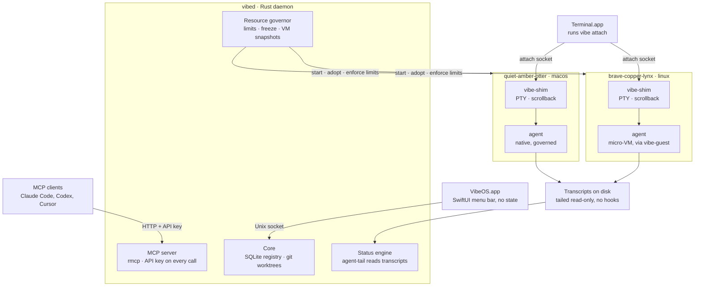
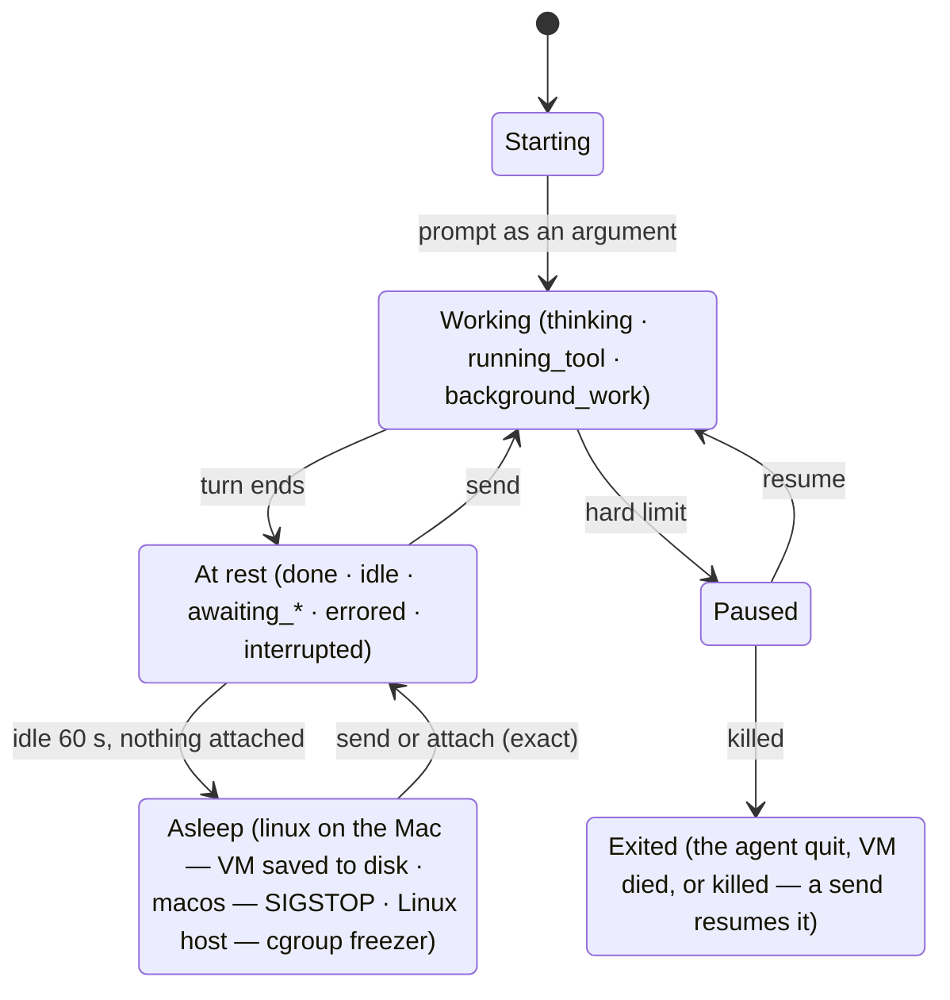

# VibeOS Native — Product Requirements

Oct 30, 2026 · @Lee

## Summary

VibeOS Native (repo: `vibe-os-native`) turns an always-on Apple Silicon Mac on the latest macOS into a private agent host, and can add Linux servers (a VPS, say) as more hosts. It has three parts: a Rust daemon, an MCP server and a SwiftUI menu bar app. The same daemon runs on every host; the menu bar runs on the Mac. Every agent gets its own git worktree and its own compartment. The agent's profile picks the compartment: a Linux micro-VM, or native macOS under a resource governor when the work needs a Mac.

The MCP server is the main interface. The menu bar lists the agents this app started on every host, with live status, so a Linux server feels like part of the Mac. Clicking one opens Terminal.app attached to its session. Closing the window detaches; the agent keeps running.

Status comes from agent-tail, which reads the coding agents' own transcripts, Claude Code's or Pi's, so no hooks are needed. That's what lets the daemon put idle agents to sleep and give their resources back. VibeOS inspired the product, but there is no shared code and no compatibility promise.

## Goals and non-goals

v1 is one owner, one Mac, any number of Linux hosts, many agents. MCP matters most: the menu bar and Terminal are views onto what MCP drives. The menu shows only agents this app started, never other agent processes on the machine.

**Goals**

1. **MCP is the control plane, shaped like VibeOS's.** The round that already drives a working orchestrator stays: start an agent with a prompt, `vibe_wait`, read what it said, answer its questions with `vibe_send`. It's folded to one agent per worktree. Host setup (projects, profiles, the Linux template) lives in Settings.
2. **One agent, one worktree, one compartment.** Agents never share a checkout, because parallel work no longer needs sequencing inside one worktree.
3. **Profiles pick the agent and the environment.** Each project has a few profiles, such as `software-eng-linux` and `software-eng-mac`. A profile sets the agent (Claude Code or Pi), the environment, model, reasoning level, permission mode and memory. `linux` is a micro-VM; `macos` runs natively under a resource governor, for Xcode and other Mac toolchains.
4. **Many agents, responsive hosts.** An agent's memory is a ceiling, not a reservation: start as many as you like, such as ten 4 GB agents on a 12 GB host, and the host swaps if they really use it all. VibeOS never refuses an agent for memory; it holds each to its ceiling and shows what each, and each host, really uses. Asleep agents use no CPU, and asleep `linux` VMs no RAM, so many more can exist, limited only by disk. No agent can starve macOS, the daemon or another agent of CPU (`reserve_cores`, `cpu_cores`) or processes (`max_processes`), and none can take more memory than its ceiling.
5. **Know what every agent is doing without hooks.** agent-tail reads Claude Code's and Pi's transcripts, and no agent's config is changed: per-launch flags and extensions only. (A per-launch flag such as Claude's `--mcp-config` or Pi's `-e` writes nothing, so it's allowed: see Shared MCP services.)
6. **Idle agents cost close to nothing and wake exactly where they were.** About a minute after agent-tail says an agent is at rest with nothing attached, a `linux` VM is paused and saved to disk, freeing all its RAM, and a `macos` agent is frozen. A send or an attach brings it back mid-prompt, even mid-question.
7. **No custom terminal.** Clicking an agent opens Terminal.app attached to the live session. Closing it detaches.
8. **Nothing is lost by accident.** Agents survive the menu bar app quitting, the daemon restarting or upgrading, and clients disconnecting. After a reboot they come back asleep. Deleting an agent with unsaved work is refused.
9. **Short setup.** About five minutes on a Mac where `gh` and `claude` are already logged in: add a project, keep or edit its two starter profiles, and log the Linux toolbox into `gh` once.
10. **Linux servers are part of the same menu.** Add one by its SSH address; the app installs the daemon over SSH. Its agents show up in the menu bar and in the Mac's MCP like local ones, and clicking one attaches over SSH. A Linux host also runs on its own, with its own MCP, when the Mac is off.
11. **One external address.** A Linux host with a public address can be the front door for outside MCP callers: one URL and one API key reach agents on that host and on the Mac behind it, with nothing opened on the Mac.
12. **Shared MCP services, one login for the whole install.** A curated set of MCP services, Linear first, available to every agent with no per-host configuration: no `claude mcp add`, and no file edits. You sign in once, with a browser on the Mac. One host owns that login and hands the others short-lived access tokens, so a Linux host that owns it keeps its services while the Mac is off. The app shows one status, and which host owns it. A refresh token never leaves the host that owns it.

13. **Every host works alone.** The Mac is optional for a Linux host: its public MCP and its shared services keep working while the Mac is asleep or off (Lee, Nov 3). For a shared service that has one limit, as there's one sign-in for the install (Lee, Nov 4): a host goes on for as long as it holds a login or a token, as Shared MCP services sets out.

**Non-goals for v1**

- Harnesses other than Claude Code and Pi.
- Several agents in one worktree.
- Reaching ports inside `linux` VMs (dev servers, previews). Agents test from inside their VM.
- A menu bar on a Linux host. Linux hosts are driven from the Mac's menu bar, over MCP, or with the `vibe` CLI.
- A browser desktop, a custom terminal emulator, or terminals other than Terminal.app.
- File sandboxing for `macos` agents, or tracking and cleaning up what they install outside their worktree. They are trusted and only resource-limited. Deleting one removes everything VibeOS made for it (see Delete), but not what the agent installed elsewhere on the Mac. Work that needs containment belongs in `linux`.
- Network egress filtering.
- Custom VM images or Dockerfiles. The Linux template covers customization.
- Multiple users or teams on one host.
- Micro-VMs on Linux hosts. Most VPSes have no KVM, so Linux-host agents run under cgroups instead (see Hosts).
- Running macOS GUI apps or Xcode simulators inside `linux` VMs.
- Orchestration logic such as planning, queues or merge bots. Clients build that on top of MCP.
- A hosted cloud relay. Outside callers reach agents through a Linux host the owner runs (see External access).
- OAuth for consumer connectors such as claude.ai's. External access uses API keys only. (Outbound OAuth from a host to the curated MCP services is a different thing: see Shared MCP services.)
- User-added MCP servers as shared services: the set is curated. The owner's own servers keep working as they always have.

## Lineage: what VibeOS taught us

VibeOS proved out the ideas, so this product borrows them. Nothing else carries over: no code, no API compatibility, no shared users. The biggest lesson changes the model: agents work best isolated from each other. A VibeOS workspace with several windows becomes, here, one **agent** per **worktree**.

| Area | VibeOS (the inspiration) | This product |
| --- | --- | --- |
| Host | Debian/Ubuntu VPS | Apple Silicon Mac, always on |
| Language | Bun / TypeScript | Rust daemon + SwiftUI menu bar app |
| Primary UI | Browser desktop with xterm windows | Menu bar + Terminal.app |
| Unit of work | A workspace (worktree) holding several windows | One agent with its own worktree and compartment |
| Profiles | Harness, flags, standing prompt with blanks, colour | Environment, model, reasoning level, mode, memory |
| Session persistence | dtach, one socket per window | `vibe-shim`, one per agent (dtach-like, built in) |
| Attach | Browser SSH (WASM), or `ssh … vibe-os attach` | `vibe attach` over a Unix socket; `ssh -t host vibe attach` when remote |
| Agent status | Screen heuristics + Claude's session registry | agent-tail reading Claude Code's transcripts |
| Resource limits | systemd scope per window (`MemoryHigh` / `MemoryMax`) | Compartment per agent: Linux micro-VM or native macOS under a governor |
| Idle savings | Hibernate idle Claude windows after N minutes, then `--resume` | `linux` VMs saved to disk, `macos` agents frozen; both wake exactly where they were |
| Auth | Static bearer token + SSH CA | Mandatory API keys made in Settings |
| MCP | `vibe_*` tools over HTTP and stdio | The same round and semantics, folded to one agent per worktree |

**Ideas borrowed, reimplemented from scratch:** worktrees named with three random words, branching from `origin`'s default branch, `push.autoSetupRemote`, per-project profiles, the MCP round (a `vibe_wait` that waits for the reply to the last send, `keys` for menus), and the conservative idle rules.

## Core concepts

An agent, its worktree and its compartment are one unit. They're created together and deleted together, and one ref (e.g. `quiet-amber-otter`) names all three. The branch is the bare ref too, with no prefix. Every agent also belongs to a host, from day one: refs are unique per host, and an agent on another host is written `vps:quiet-amber-otter` when the host isn't clear from context.

| Term | Meaning | Lives at |
| --- | --- | --- |
| Host | A machine running `vibed`: the Mac, or a Linux host. Each host keeps its own projects, profiles and agents; the Mac's menu and MCP show all of them. One owner for all. | — |
| Linux host | A Linux server (a VPS, say) added by its SSH address. `vibed` runs there as a systemd user service, and agents run natively under cgroups v2. | The server |
| Project | A GitHub repo cloned onto a host by `owner/name`, or a local repo registered by path. Added in Settings, where its profiles live too. | `~/VibeOS/projects/<name>` |
| Profile | A per-project preset for starting agents: agent (Claude Code or Pi), environment, model, reasoning level, mode (`auto` or `bypass`) and memory. A new project starts with one per environment. | Settings → Projects (SQLite) |
| Agent | One Claude Code or Pi process and all its children, started from a profile, working in its own worktree inside its own compartment. | Process tree under a shim |
| Worktree | The agent's git worktree, on its own branch. Deleted with the agent; the branch is kept. | `~/VibeOS/worktrees/<project>/<ref>` |
| Compartment | The agent's isolation boundary: a micro-VM for `linux` on the Mac, a cgroup on a Linux host, a governed process tree for `macos`. | — |
| Environment | `linux` or `macos` (`macos` only on the Mac). Set by the profile, and fixed for the agent's life. The host decides how `linux` runs: a VM on the Mac, a cgroup on a Linux host. | The profile |
| Linux template | The Linux machine every `linux` agent boots a copy of: whatever you install in the toolbox shell (`apt`, `curl … \| sh`, `npm -g`). Versioned. | Host disk image |
| Linux home | Logins and dotfiles every `linux` agent starts with (`gh`, `gcloud`, `~/.gitconfig`), set up in the toolbox shell. Kept apart from the template so a rebuild doesn't lose them. | Host disk image |
| Linux Claude config | Your Claude setup for `linux` agents (CLAUDE.md, settings, skills, MCP servers), made in the toolbox shell. Copied into each agent's own `~/.claude` when it starts. | `~/VibeOS/linux-claude/` |
| Linux Pi directory | What you keep for Pi in `linux` agents: settings, models, extensions. Every Pi VM has it as a share read-only at virtio-fs, so only you on the Mac can change it. | `~/VibeOS/linux-pi/` |
| Linux Pi logins | Your one Pi login for `linux` agents. No guest mounts it, and only the daemon writes it. | `~/VibeOS/linux-pi-logins/` |
| Linux Pi toolbox agent dir | The toolbox's own private copy of that login, where `/login` there writes. Each Pi VM has one like it in its own directory. | `~/VibeOS/linux-pi-signin/` |
| Managed layers | Tools the daemon keeps for `linux` VMs: Claude Code, kept current, for every agent that runs it, and in a layer of its own the Pi version this build pins, for those that run Pi. | Host disk images |
| Toolbox shell | A Terminal session in a writable Linux VM, for changing the template and the Linux home. | Settings → Linux Toolbox, or `vibe toolbox` |
| Host limits | Everything that isn't per profile: cores kept for macOS, CPU cores per agent, agents awake at once, process count, disk. | Settings → Host, or `~/.config/vibeos/host.toml` |
| Snapshot | A sleeping `linux` agent's whole VM, RAM included, saved to disk. Restoring it resumes the agent exactly, but for what its processes held on a share (Going to sleep). | `~/VibeOS/snapshots/<ref>` |
| Session | The PTY the agent runs in. A shim holds it, so it outlives every client. | `…/run/<ref>.sock` |
| Transcript | The session file the agent writes on its own. agent-tail reads it to get status. | Claude: `macos` and Linux hosts, `~/.claude/projects/`; `linux` on the Mac, the agent's own Claude home on the Mac. Pi: `macos` and Linux hosts, `~/.pi/agent/sessions/`; `linux` on the Mac, the agent's own `pi-sessions/` on the Mac |
| Client | Anything attached to an agent or calling `vibed`: Terminal via `vibe attach`, an MCP client, or the menu bar app. | — |

## Key user flows

An agent's life runs setup → start (worktree and compartment included) → work → sleep or attach → finish → delete. Every step works over MCP, and most also work from the menu.

1. **Install and setup.** Drag `VibeOS.app` into Applications. On first launch it registers `vibed` as a LaunchAgent (`SMAppService`), links `vibe` into `/usr/local/bin`, and runs a doctor checklist:
   - `gh auth status`. Git using `gh`'s login and GitHub's SSH host keys are VibeOS's to set up (see Add a project). The first is on the list only if setting it up fails; the second has no check, and a failure to add the keys is only logged, as a clone can still go over HTTPS.
   - git, the `claude` binary, and its login
   - Automation permission to control Terminal
   - power: no system sleep (v1 assumes the Mac stays up)
   - Tailscale (optional, for remote MCP)

   The list is only ever what truly needs the owner: a sign-in, or a permission only they can give. What VibeOS can set up, it sets up without being asked, at install, at each launch of `vibed` and every hour after, and a check of it shows only if that fails, with what was said (#74). So far that covers git using `gh` and GitHub's host keys (see Add a project), `vibed` staying up on a Linux host (see Adding a Linux host), and Pi once a profile runs it. Asking `vibe doctor` has it try at once, but for the Linux images, whose download it leaves to `vibed`'s own hourly try and the app's **Try Again**, as it would otherwise start one each time it's asked. There's no step to fix things (`--fix` still works, and means nothing now). Signing in is one click, with no terminal. GitHub and Claude, on a Linux host or the Mac, and GitHub and Claude for a Mac's linux agents, each start from a button: `vibed` runs the provider's own flow where the login's to live (`gh auth login --web`, `claude auth login`, `vibe setup-token`) and reads the page and code it says it wants. The app shows the code, and opens that page in the Mac's browser if it's the provider's own. A page comes from the host's word alone, so any other takes a click that says where it goes. A page that shows a code to bring back has a field for it. VibeOS signs nobody in: on a host, the provider's own tool writes the login. For linux agents, GitHub signs in on the Mac into a private directory of its own, so the owner's login there isn't touched. Its token goes on to `gh` in the toolbox's Linux home, the directory's removed as soon as it's read, and a login that's been approved isn't lost by closing the window. If the toolbox is in use it waits, for up to ten minutes. Claude's long-lived token goes to Keychain, as `vibe setup-token` has always kept it.

  What's missing installs itself, at each launch of `vibed` and every hour. `gh`, the version this build pins, goes under VibeOS's data directory from GitHub's releases, checked against the sums published with them, and is linked at `~/.local/bin`. Claude Code is the newest build, checked against its manifest, which then runs its own `claude install`, so it lives in Claude's own layout and goes on updating itself. Neither goes over one of the owner's, and a `claude` that's there and doesn't run is left for them to look at. `git` on a Linux host goes in with the server's package manager, with `sudo -n` once a run, or Allow… in Settings → Hosts. On a Mac it's Apple's Command Line Tools, from the setup's button. So `vibe doctor` on a fresh host or Mac lists only the sign-ins, macOS's own permissions, and what needs an admin or Apple's tools.

   Meanwhile it downloads the Linux base image and the current Claude Code. Then it offers two last steps:
   - **Set up Linux.** The toolbox shell opens in Terminal, for anything you want every Linux agent to have (`gcloud auth login`, `apt install …`, your agent settings). Exit to save. Linux agents sign in to Claude with a long-lived token that `vibe setup-token` gets (it runs `claude setup-token`, the same browser sign-in as `/login`) and keeps in Keychain. GitHub for Linux agents is a button in the setup and in Settings → Linux Toolbox. Setup doesn't walk through Claude's sign-in; Settings → Linux Toolbox shows a one-line hint and a button while it's missing.
   - **Settings → API keys → New key**, with a ready `claude mcp add …` line to copy.
2. **Add a project.** Settings → Projects → Add takes a GitHub `owner/name`, cloned with the host's `gh` login into `~/VibeOS/projects/`, or a local path. The project starts with two profiles, one per environment (see Profiles), which you can edit or add to. A GitHub project clones the first time on a fresh Mac or Linux host, with nothing run by hand, however `gh` is set up. `vibed` sets up what git and `gh` need at startup, at each hourly check of `gh` and before each clone, without being asked, once `gh` is logged in: GitHub's SSH host keys, pinned in the build, are added to `~/.ssh/known_hosts` under `github.com` and `[ssh.github.com]:443`, GitHub's way round a blocked port 22, for each type of key it has none of, with nothing there changed. A pin goes in only if GitHub still publishes that key, asked over TLS with `gh`'s login, so a build in the field can't bring back a key GitHub has dropped; if it can't be asked, none goes in and a clone can still go over HTTPS. It then runs `gh auth setup-git`, unless git already has a credential helper of the owner's own just for GitHub, which that would replace. So a first connection over SSH is checked against those keys: SSH's checking of a host key is never turned off, and no key is ever accepted on first sight. If a clone over SSH still fails for a reason of SSH's (a host key that doesn't match, no SSH key this account has on GitHub, a blocked port, no `ssh`), that clone goes once more over HTTPS, with `gh`'s login, so its `origin` is HTTPS. `gh`'s own protocol setting is the owner's and is never changed, so the next clone tries SSH first again. That's also what happens if GitHub rotates its keys, until a build has the new ones. What only the owner can do is said in the app, with `gh`'s own words: signed out, or a token gone bad, says to sign in on that host, with a button in Settings → Hosts. Any other failure, such as a network that's down, says what `gh` and git said. The clone isn't left half done in any of these. On the Mac, removing a project forgets it and its profiles but leaves its files on disk; adding the same repo again picks up its existing clone. On a Linux host, removing a project cloned from GitHub can also delete its clone, and only that: a git repo directly inside `~/VibeOS/projects/`, reached without a symlink, whose `origin` is the project's repo, never the folder itself or anything holding the home folder. Deleting takes explicit intent: Settings asks first, and `vibe project remove` needs `--delete` (the socket call, `delete`); without it, a removal that would delete a clone is refused and says what it would delete. A clone that fails those checks is never deleted: with `--delete` the removal is refused with the reason, and without it the project is only forgotten, its files left. The answer says whether the clone was deleted. A removal waits for starts and git maintenance under way in the project, and holds new ones off until it's done. A local repo registered by path is the owner's own and is left as it is. While the host can't be reached, the removal fails and says so, and nothing changes. A project with agents can't be removed.
3. **Start an agent.** `vibe_start_agent {project, profile, prompt}`, or New agent… in the menu. One call does it all:
   - fetch `origin` and cut a worktree on a new branch from the default branch (or from `from`), with `push.autoSetupRemote` set. Agents get their git settings through their environment (`GIT_CONFIG_*`), so the shared `.git/config` is unchanged
   - check there's room: disk to spare, and fewer than `max_awake_agents` awake. Never memory: the profile's memory is the agent's ceiling, not a reservation
   - create the compartment: boot the VM for `linux`, or set up the governed tree for `macos`
   - run the optional `.vibe/setup.sh` inside it
   - pre-fill Claude's state so it opens straight to its prompt: first-run onboarding done (otherwise Claude stops at its theme picker) and the worktree trusted. Then start the shim, and launch `claude --session-id <uuid>` with the profile's model, reasoning level and mode. The prompt is an argument, never pasted, so a startup dialog can't swallow it. A Pi profile starts the same way, with nothing to pre-fill: first, Pi's own `pi auth check` where it can be run, or a look at its login files in a VM, so a profile whose model it has no login for is refused. Then `pi --session-id <uuid>` with its model and thinking level, `--approve` for the worktree, and the prompt after `--`, with a space before a leading `@`, which Pi would otherwise read as a file to attach.
   - agent-tail starts tailing the transcript

   If a step fails, the steps before it are undone, the new branch included, and the call says why (for `.vibe/setup.sh`, its last line of output). The agent's record is written first, so a start cut short by a crash of `vibed` is undone the same way when `vibed` starts again.
4. **Monitor.** The menu bar row shows state, title and the latest activity line. A notification fires when an agent has a question, errors or hits a limit. MCP clients use `vibe_wait`.
5. **Attach.** Click the row and Terminal.app opens running `vibe attach <ref>`. If a tab is already attached, that tab is raised instead. Closing the window detaches; the agent keeps running.
6. **Go idle.** About a minute after the agent comes to rest with nothing attached, it goes to sleep: a `linux` VM is saved to disk and its RAM freed, and a `macos` agent is frozen. A send or an attach wakes it exactly where it was, including mid-question.
7. **Finish.** The agent commits, pushes and opens a PR itself, in either environment. It uses the Mac's `gh` login in `macos`, and the Linux home's in `linux`.
For linux agents, git in the Linux home reaches github.com over HTTPS with `gh`'s login, for an `origin` of the form `git@github.com:` or `ssh://git@github.com/`, so a project with an SSH `origin` pushes with that login however the home was signed in. Signing in from the app sets this in the home. For a home signed in another way, each agent's VM sets it up on that agent's own disk as it comes up (at boot, launch and wake), so no new sign-in is needed. The home's image, its `~/.gitconfig` and the project's own config aren't changed. It's left alone where SSH may work: `core.sshCommand` is set, or `~/.ssh` has a key or config and GitHub's host key is known or that config sets its own host-key handling or uses `Include`. A helper git already has for GitHub is kept.
8. **Delete.** `vibe_delete_agent` ends the agent and removes everything VibeOS made for it: the worktree, its temp directory (the shim points `TMPDIR` at `~/VibeOS/agents/<ref>/tmp`), Claude's transcripts for that worktree, its scrollback, socket and record, and in `linux` its VM disk, Claude home and snapshot. The branch is kept. Deletion is refused if there are uncommitted changes or unpushed commits, unless `force` is set. Unpushed means on the agent's branch, or its worktree's `HEAD`, but on no remote-tracking branch; `vibed` fetches without pruning, so a branch merged and deleted on GitHub still counts as pushed. In a repo with no remote, it means on no other branch. Nothing is deleted automatically.
9. **Reboot.** `vibed` starts at login and marks every agent `asleep`. A `linux` agent wakes from its snapshot exactly where it was; a spike confirmed snapshots survive a reboot. A `macos` agent's processes are gone, so it wakes by continuing its conversation with `claude --resume`.

## Architecture

A Rust daemon owns all state and logic. Every other part is a thin client of it. Agents live in per-agent shims, so the daemon can restart or upgrade without killing any of them.

| Component | Language | Runs as | Job |
| --- | --- | --- | --- |
| `VibeOS.app` | SwiftUI (`MenuBarExtra`) | Login item | UI only, holds no state. Talks to `vibed` over a Unix socket. Quitting it changes nothing. |
| `vibed` | Rust | On the Mac a LaunchAgent (via `SMAppService`); on a Linux host a systemd user service. Always as the user, no root | Registry (SQLite); worktree manager (shells out to `git`); agent supervisor; **status engine** (agent-tail); **resource governor** for `macos` agents; sleep and wake; Linux template, home and managed-layer builder; MCP server; event stream. |
| `vibe-shim` | Rust | One per awake agent, on the host, detached (its own session) | Owns the agent's terminal end: PTY (`macos`) or a vsock stream to `vibe-guest` (`linux`), a scrollback ring buffer, and a screen model (`vt100` crate) for `read_output` and redraw on attach. Serves `run/<ref>.sock`. |
| `vibe-vm` | Swift (Virtualization.framework) | One per awake `linux` agent, detached | Boots the agent's VM, or restores it from its snapshot. Serves `run/<ref>.vm`, which carries vsock streams into the guest for the shim. To sleep, it pauses the VM, saves its state to disk and exits. Holds the `com.apple.security.virtualization` entitlement. |
| `vibe-guest` | Rust, static Linux binary | PID 1 inside each VM | Starts Claude as the unprivileged user `vibe` on a PTY. Reports the process tree for the idle rules. Freezes Claude's tree before a save. After a restore, sets the clock from the host, waits for the shared folders to answer, then thaws Claude. If the vsock link drops, Claude keeps running until the shim reconnects. Serves the shared services' socket to the agent, and carries it to the Mac over a relay the Mac dials. Its contract, the kernel command line it boots with and its vsock ports, is in `protocol/vibe-guest/`. |
| `vibe` CLI | Rust | On demand; linked into `/usr/local/bin` at setup | `vibe attach <ref>`, `vibe ls`, `vibe doctor`, `vibe toolbox`, `vibe setup-token` (the Claude login for `linux` agents), `vibe mcp` (a stdio bridge for clients that can only start a command), `vibe rpc` (the socket API over stdio, which the Mac uses through SSH), `vibe mcp-proxy` (a shared service over stdio, as agents' MCP clients start it), and `vibe key`, `vibe project`, `vibe profile`, `vibe service` and `vibe pi` for setting up a Linux host without the menu bar. |

**Restarts.** Shims and `vibe-vm` processes are detached from `vibed`. A daemon crash or upgrade leaves every agent running, and on start `vibed` re-adopts them by scanning `run/`: a shim serves `<ref>.sock` there and a `vibe-vm` `<ref>.vm`. Each shim leads its own session and process group, so launchd ending `vibed`'s job leaves them alone; on a Linux host the systemd unit (#16) must use `KillMode=process`, or restarting `vibed` would kill the shims in its cgroup.

**Sessions.** `vibed` starts a shim as `vibe-shim --ref <ref> --socket run/<ref>.sock --state ~/VibeOS/agents/<ref> -- <command>`. Like `dtach -n`, it binds the socket (with a lock beside it, so there's one shim per ref), forks a process that leads a new session and owns a new terminal, starts the command in its own process group as that terminal's foreground, prints its pid once the command runs, and exits. The shim's pid is therefore the session ID of everything the agent starts (the governor freezes those processes, never the shim itself, which must keep answering), and if the shim dies the kernel hangs up the command. The shims are the record of what's running: `vibed` keeps no session state of its own, and finds every session, after a restart too, by asking the shim behind each session socket in `run/`; a socket nobody serves is removed. A shim binds its socket with a lock beside it, so a socket without one is never taken for a session nor removed; nor are `vibed`'s own sockets there (`vibed.sock`, a Linux host's tunnel end `mac.sock`, the Mac's `tunnel.sock`, and every host's `.services.sock`, which no ref could name), so none is ever removed as stale. When the command exits, the shim tells attached clients how, leaves `session.json` (the exit, the last screen and the history) and `shim.log` in the agent's directory, removes its socket and exits. A size from a client is capped at 1000 rows and columns, input waiting for a command that doesn't read is capped too, and a client that stops reading for 30 s is dropped. A shim's socket speaks a small framed protocol of its own (`vibe_core::shim`), spoken only by `vibe attach` and `vibed`, never by the Swift app: terminal bytes as they are, JSON for the rest. For a `linux` agent on the Mac, Claude runs in the VM: `vibed` launches it through `vibe-guest`, and starts the shim with `--vm run/<ref>.vm` instead of a command, to attach to `vibe-guest`'s terminal through `vibe-vm`. If that stream drops, the shim exits without a record and Claude goes on in the VM. The socket API has `sessions.list` and `sessions.attach` (and `agents.start`, `agents.list` and `agents.delete` for agents themselves); the latter gives the shim's socket, the window title and the ttys of clients already attached. A ref is at most 32 characters, because `run/<ref>.sock` must fit in a socket path's 104 bytes on macOS, and a new agent can't be named `vibed`, `mac` or `tunnel`, in any case, the names of those sockets. An agent already named `mac` or `tunnel` (only `vibed` was reserved before) still works and can be deleted. However much the command writes, a shim stays responsive: what the terminal says waits on a short queue of its own and is handled after everything else, one chunk at a time, so under a flood of output a request, a signal or a client waits for the chunk in progress at most. A send to a program that's just been started, by a resume, a wake or a start, first waits for it to turn on bracketed paste, or for its screen to settle, for up to 30 s from its start: typed sooner, it sits in a terminal that isn't raw yet, so its Enter becomes a newline in the text and nothing is submitted. That's as much as can be told for Claude. A Pi can look ready while its startup goes on, and hands back what's submitted, to its editor: so while the text's still there, Enter is pressed again, and after 60 s the send fails saying where the text is.

**One core, three doors.** The menu bar, the CLI and MCP all call the same core handlers inside `vibed` over JSON-RPC 2.0, so they can't drift apart. MCP is a façade on that core, built with `rmcp` (the official Rust MCP SDK).

**One `vibed` per state directory.** `vibed` takes the state directory's lock before it binds any socket. A second `vibed` on the same state is refused with nothing bound, so anything that can connect to a `vibed` socket knows the state lock is that `vibed`'s. It can still fail after that, opening a state database that's corrupt, say, and exits saying why.

**The socket contract.** The API is plain JSON-RPC 2.0, one message per line (UTF-8, `\n`-terminated, at most 16 MB), with batches and params by name. The same framing runs on the local socket and through `ssh <host> vibe rpc`. Every client opens with `daemon.hello {client, protocol}`; the daemon refuses a different protocol version with error `-32000` and its own version in the error's data. A client that wants the event stream calls `events.subscribe` on a connection of its own, which then also carries an `events.event` notification for every event: registry changes, `gh` login changes, and, as those parts land, agent state changes and limit hits. Over the socket, sizes are bytes and durations seconds. The socket is `~/Library/Application Support/VibeOS/run/vibed.sock` on the Mac and `~/.local/share/vibeos/run/vibed.sock` on a Linux host, or `$VIBE_SOCKET`. Its directory is `0700`, the socket is `0600`, and a lock file beside it keeps a second `vibed` off it. The contract lives in `protocol/`: an index of the methods, error codes and every type's field names, plus golden request/response examples. The Rust types (`vibe_core::rpc`) and the Swift types (`VibeRPC` in `swift/VibeOS`) are both tested against those files, and `vibed` must answer every example exactly, so neither side can change alone.

**No Rust in the Swift processes.** The Swift app talks to `vibed` only through the socket. There is no UniFFI and no linked library, which keeps the Swift side small and the builds independent. `vibe-vm` is Swift too, because Virtualization.framework is an Apple API; it's a separate process that `vibed` drives. `vibed` starts it with stdout on a pipe, reads the one line it prints once the VM runs (or why it couldn't), and from then on talks to it on its control socket, `run/<ref>.vm`, which a restarted `vibed` finds again. Its contract, with the VM configuration `vibed` writes for it, is in `protocol/vibe-vm/`, and `vibe_env::vm` is the Rust side.

**Crates:** `vibe-core` (domain + store, and the socket contract), `vibe-status` (wraps agent-tail), `vibe-env` (environment backends, below, and the driver for `vibe-vm`), `vibe-shim`, `vibe-guest`, `vibe-mcp`, `vibe-services` (the shared services' broker, in every `vibed`), `vibe-relay` (their stdio shim, and the relay out of a VM; `std` only, as `vibe-guest` links it), `vibe-cli` (the `vibe` binary), and `vibed` (the daemon binary). One more, `vibe-testguest`, is a test fixture and never ships: PID 1 of a small Alpine-based guest (`scripts/test-guest.sh`) that `vibe-vm` is tested with end to end. Everything builds for macOS and Linux, x86_64 and arm64, but `vibe-guest` and `vibe-testguest` do their work only as static `aarch64-unknown-linux-musl` binaries, linked with the toolchain's own `rust-lld`, so they cross-build on a Mac with no C cross-compiler. The Swift app, `vibe-vm` and the `macos` governor are Mac-only: two Swift packages, `swift/VibeOS` (the app and its `VibeRPC` socket client) and `swift/vibe-vm`. For local development both are signed ad hoc, `vibe-vm` with the `com.apple.security.virtualization` entitlement (`scripts/sign-macos.sh`). `scripts/check-full.sh` runs every check in one command, and CI runs the same script.

### Environment backends

Every way of running an agent sits behind one small interface, so the policy code (sleep, admission, MCP, the menu) never asks which backend it's talking to. It's three focused traits and a capabilities record, not an inheritance tree:

```rust
trait Compartment {               // lifecycle: every backend
    fn create(&self, spec: &AgentSpec) -> Result<Handle>;
    fn run(&self, h: &Handle, cmd: &Run) -> Result<RunOutput>;         // to completion: .vibe/setup.sh
    fn launch(&self, h: &Handle, cmd: &Launch) -> Result<TerminalEnd>; // PTY or vsock, for the shim
    fn processes(&self, h: &Handle) -> Result<Vec<Proc>>;              // for the idle rule
    fn stop(&self, h: &Handle) -> Result<()>;
    fn delete(&self, h: &Handle) -> Result<()>;                       // leaves nothing behind
}
trait Limiter {                   // governor, cgroups, or fixed at VM boot
    fn apply(&self, h: &Handle, limits: &Limits) -> Result<()>;
    fn usage(&self, h: &Handle) -> Result<Usage>;
}
trait Sleeper {                   // SIGSTOP, cgroup freezer, or snapshot
    fn sleep(&self, h: &Handle) -> Result<()>;
    fn wake(&self, h: &Handle) -> Result<Woke>;  // exact, exact on a new terminal, or --resume
}
struct Capabilities { sleep_frees_memory: bool, exact_after_reboot: bool,
                      kernel_limits: bool, file_containment: bool, wake_cost: Duration }
```

| Backend | Limits | Sleep | Sleep frees RAM | Exact after reboot | Files contained |
| --- | --- | --- | --- | --- | --- |
| `macos` on the Mac | Supervised (governor) | `SIGSTOP` | No (macOS may swap) | No, `--resume` | No |
| `linux` on the Mac | Kernel, fixed at VM boot | Snapshot to disk | Yes | Yes | Yes |
| `linux` on a Linux host | Kernel (cgroups v2) | cgroup freezer | No (may swap) | No, `--resume` | No |

Policy reads only the traits and `Capabilities`. For example, memory pressure ends frozen agents only where `sleep_frees_memory` is false, as their sleep didn't give their memory back. "Freeze a process tree" is one shared building block: the `macos` sleeper, the cgroup freezer and `vibe-guest`'s freeze-before-snapshot all use it. A later backend, such as Firecracker on a Linux host that has KVM, is one new implementation.

One conformance test suite holds every backend to the same contract: start, then its processes are visible; a limit hit pauses it; sleep then wake leaves the session exactly where it was, or reports `--resume` when `exact_after_reboot` says so; delete leaves nothing behind.

**Status engine.** It wraps agent-tail's `SessionReducer`. `vibed` matches each agent to its transcript and feeds in the bytes as they're appended (details under State and lifecycle). The shim's screen model is a fallback only, for the rare moment a transcript can't be found.



`vibed` sets up an attach: it finds the agent and wakes it if needed. After that, Terminal's bytes flow straight to the shim, so a daemon restart doesn't interrupt an attached session.

## Environments and profiles

Every agent runs in its own compartment, in the environment its profile names. `linux` is a micro-VM with hard limits and its own kernel. `macos` runs natively under `vibed`'s resource governor, for work that needs Xcode, Swift or other Mac-only toolchains.

| Environment | How it runs | Enforces | Sleeps by | Pick it for | Logins and binaries | Trust |
| --- | --- | --- | --- | --- | --- | --- |
| `linux` | Micro-VM per agent on Apple's Virtualization.framework | vCPUs and RAM fixed at boot; separate kernel and filesystem | Saving the VM to disk: RAM freed, exact restore | Most work: web, backend, CLIs, anything that builds on Linux | The Linux toolchain and home, plus Claude's long-lived token | Isolated from the host and from other agents |
| `macos` | Native processes under `vibed`'s governor | CPU, memory, process count and disk, by supervision | `SIGSTOP`: exact; macOS compresses or swaps the memory | iOS and macOS apps, Xcode, Swift, Homebrew-only tools | The Mac's own binaries and logins, as you | Runs as you, with no file sandbox: the governor protects the machine's resources, not your files |
| `linux` on a Linux host | Native processes in a cgroup v2 per agent | CPU, memory, process count by the kernel; disk by measurement | cgroup freezer: exact; memory stays, and may swap | Work that should run on a server, or more agents than the Mac holds | The server's own binaries and logins | Runs as the server's user; protects the server's resources, not its files |

### Profiles

A profile is everything you choose when starting an agent, saved under a name. Profiles belong to a project and are edited in Settings → Projects. A new project starts with these two:

| Profile | Agent | Environment | Model | Reasoning | Mode | Memory |
| --- | --- | --- | --- | --- | --- | --- |
| `software-eng-linux` | Claude | `linux` | Opus | high | auto | 4 GB |
| `software-eng-mac` | Claude | `macos` | Opus | high | auto | 4 GB |

- **Agent:** Claude Code by default, or Pi. Starter profiles are Claude's; a Pi profile, `pi-linux`, is one click in Settings → Projects. What's saved without an agent is Claude's.
- **Model:** for Claude, Opus or Sonnet (`--model`). For Pi, whatever Pi is to be given as `--model`, as it is, such as `openai/gpt-5` or a bare `deepseek-v4.1-flash`, or none for what Pi's own settings and logins give. VibeOS doesn't pick a provider. Settings offers Pi's own list for that host and environment to search and choose from, with Pi's default first and each provider marked signed in or not, and anything else can be typed: a bare id with one owner in the list becomes `provider/id`, one with several shows them to choose from, and one Pi doesn't list is saved as it is, as Pi may know it (an extension's, say, which the list leaves out). `vibed` gets the list by running the Pi this VibeOS pins, offline, spending no token (a `!command` of the owner's own in that agent dir runs, as whenever a Pi starts there), and keeps it until the files it comes from change, so a new look costs a second at most and is never out of date. A provider Pi says isn't signed in, whether its model came from the list or was typed, gets its sign-in offered under the field. Nothing in the list decides what's allowed. When saved, a model is only checked to be safe to pass as one argument: no whitespace or control characters, none of `'`, `"`, `` ` ``, `$` or `\`, no leading `-`, and at most 200 bytes. For a login it's checked when an agent starts. Whether Pi has such a model, and which provider's it is, only Pi can say, once it runs (decided by Lee, Nov 4). A model Pi won't take, one it doesn't know or a bare id several providers have, whether or not they're signed in, ends Pi before it draws anything. The agent then reads as `exited` and `errored` with what Pi said, without the flags Pi suggests typing: in full in its row and its tooltip, and when it's clicked. An agent keeps the model it started with, so a change to the profile is for new agents.
- **Reasoning:** Claude's effort level (`--effort`) or Pi's thinking level (`--thinking`): `low`, `medium`, `high`, `xhigh` or `max`.
- **Mode:** for Claude, `auto` by default, or `bypass` (`--dangerously-skip-permissions`), in either environment. Bypass on `macos` is the owner's call. Pi has no permission modes: it never asks before running a tool, so it's always the equivalent of `bypass`. In `linux` that needs no choice. On `macos`, with no file sandbox, it takes the same opt-in as Claude's bypass, said in the call that puts Pi there.
- **Memory:** the agent's high-water mark: a `linux` VM's fixed RAM, a Linux host's cgroup `memory.max`, or a `macos` agent's hard limit. It's a ceiling the agent is held to, never memory set aside for it, so agents' memory may add up to more than the host has. 4 GB by default, and adjustable per profile from 1 GB to 1 TB, in whole MB.

**Shared MCP services** are the same for either agent, and only their injection differs, per launch and written nowhere: Claude takes them as `--mcp-config`, and Pi as `-e vibe-services.ts`, an extension shipped with VibeOS (in the Pi layer for a VM, and beside a native agent) that registers each `vibe-<service>` from `VIBE_SERVICES` as `vibe mcp-proxy <service>`. A profile with them off gets neither. Pi never asks, so what a shared service allows, it does unprompted.

On a Linux host, a new project starts with one profile, `software-eng-linux`, with the same defaults. MCP clients see each project's profiles, with their agents, in `vibe_list_projects` and pass one by name to `vibe_start_agent`. An agent can't change profile or environment; start a new one `from` the same branch instead.

### Host limits

Everything that isn't per profile is host-wide, in Settings → Host or `~/.config/vibeos/host.toml`. `vibed` reads the file on every use, so hand edits take effect at once, and edits from Settings keep the file's comments. A setting left out of the file has its default. Every number is a proposed default to check on real hardware:

```toml
reserve_cores    = 2
max_awake_agents = 16
cpu_cores        = 4       # per agent
max_processes    = 512     # per macos agent
disk_soft        = "20G"   # per worktree
disk_hard        = "30G"
vm_disk          = "20G"   # a linux agent's own writable layer
idle_debounce    = "60s"
snapshot_disk    = "20G"   # total for all sleeping linux agents
package_caches   = true    # linux agents share npm, pnpm, cargo and pip caches
mcp_port         = 7878    # MCP on http://127.0.0.1:<port>/mcp
mcp_tailscale    = false   # MCP on this host's Tailscale address too
peer_read        = 3       # seconds another host gets to answer a listing or lookup
```

`package_caches` is the opt-out from the shared caches (Mounts, below). It and `mcp_port` are set in this file only, not over the socket. `mcp_tailscale` is also set over the socket, by Settings.

There's no admission by memory. A start or a wake never reserves the profile's memory and is never refused for memory, whatever the other agents' profiles add up to or the host's memory pressure: each agent's memory is only its ceiling, and the host swaps if its agents use more than it has. What's checked is disk (Failures, Low disk) and `max_awake_agents`: past it, agents still inside their idle debounce go to sleep early, oldest first, and if none is idle the start is refused with a clear reason. Starts never queue. `reserve_memory`, from earlier versions, means nothing now: a `host.toml` that still sets it is read as if it didn't, and `limits.get` reports it as 0 for an older `vibed`.

Instead, `vibed` reports what memory is really used: each agent's against its ceiling (what the guest reports in a `linux` VM, the cgroup's `memory.current` on a Linux host, the governor's `phys_footprint` sum in `macos`), and each host's used and total, with its swap. `agents.list` and `hosts.list` carry them, MCP's `vibe_list_agents` too, and the menu shows them. While the kernel says a host is short of memory (macOS's memory-pressure level; Linux's pressure stall information, or under 5% left where it has none), that's a warning in the menu's header and in `vibe_list_agents`, never a block.

### How `macos` is governed

macOS has no cgroups, so `vibed` supervises each `macos` agent's process tree and acts on it. There is deliberately no file sandbox, so Xcode, SwiftPM, simulators and Homebrew all work. The levers below are listed mildest first.

- **Membership.** The shim starts each agent in its own session, and every process inherits that session ID. The governor walks the tree every second (`proc_listchildpids`), and every 5 s it also matches the user's processes by session ID (`getsid`). That catches jobs that got reparented to launchd, such as `nohup … &`, in under a millisecond. An environment tag isn't used: on macOS 26, `KERN_PROCARGS2` hides the environment of Apple's own binaries (`git`, `clang`, `sleep`). A process that starts its own session (a true daemon) escapes both checks, and that's accepted. Services that launchd starts on an agent's behalf, like simulators and Xcode build services, aren't counted.
- **CPU.** The cap is in cores, measured from CPU-time deltas. Over the cap, the agent is first demoted to `PRIO_DARWIN_BG`: efficiency cores and throttled I/O, enforced by the kernel. If it's still over, `SIGSTOP`/`SIGCONT` duty cycling holds it to the cap.
- **Memory.** The governor sums `phys_footprint` (`proc_pid_rusage`). At 80% of the profile's memory, the agent is demoted and a notification fires. At 100%, the tree gets `SIGSTOP` and the agent is `paused`. The owner can raise the profile's memory and resume it, or delete it.
- **Processes.** Over `max_processes`, the tree is paused. This is the fork-bomb stop.
- **Disk.** The worktree and its temp dir are measured every minute. Past `disk_soft` a warning fires; past `disk_hard` the tree is paused.
- **Logins and binaries.** `macos` agents use the Mac's own `claude`, `gh`, `gcloud` and Keychain logins. Nothing is redirected.

### What's inside `linux`

A `linux` agent boots a stack of layers. You build the middle once, the daemon keeps the rest current, and the agent writes only to its own copy.

```
agent VM = base image      ships with the app: Debian slim, git, gh, curl,
                           ripgrep, jq, build-essential, Python 3, Node LTS, mise
         + Linux template  what you installed in the toolbox shell   read-only
         + managed layers  Claude Code, updated daily by the daemon, read-only, first on PATH
                           and for a Pi agent, Pi, the same way
         + Linux home      your logins and dotfiles                  read-only
         + agent's copy    everything this agent writes              discarded on delete
```

#### The toolbox shell

Settings → Linux Toolbox → Open Shell (or `vibe toolbox`) opens Terminal in a VM where the template and the Linux home are writable. Install any way you like (`apt install`, `curl … | sh`, `npm -g`) and log in to whatever you need. Exiting saves a new version of each as a new image file; an image is never changed in place, because a sleeping agent's snapshot depends on the exact disks it was saved with. Closing the shell's Terminal window saves too (unlike an agent's window, which only detaches), and so does **Save & Close** in Settings; the detach key (`Ctrl-\`) leaves the shell open in the background, as Settings shows, for Open Shell to attach to again, and over SSH so does a dropped connection. Old versions are deleted once no agent uses them. New agents boot the latest versions; running agents keep theirs until their next boot. Only one toolbox shell can be open at a time, and agents never change the template or the home. The shell runs as `vibe` with `sudo` (agents get no `sudo`), and `toolbox.toml`'s commands below run as root.

`~/.config/vibeos/toolbox.toml` is optional. It's a recipe the daemon can replay into a fresh template, plus update commands to run on a schedule:

```toml
packages = ["kubectl", "postgresql-client"]   # apt

[[install]]
name = "gcloud"
run  = "curl -sSL https://sdk.cloud.google.com | bash -s -- --disable-prompts --install-dir=/opt"

[update]   # run weekly in a toolbox VM; the result is saved as a new template version
run = ["gcloud components update --quiet"]
```

**Base image updates.** A new app release can ship a new base image, and the template follows it by itself: `vibed` boots the new base, replays `toolbox.toml` into a fresh template, puts back the Debian packages and global npm packages installed by hand, and keeps it as the next version, so new agents use it. An image is never changed in place, so agents that exist keep theirs until their next fresh boot, and one asleep still wakes. The Linux home carries over unchanged. What was installed by hand and that can't put back, as far as VibeOS can see, isn't dropped: then nothing moves and new agents stay on the current template, without the new base or what it brings, and Settings → Linux Toolbox says what, with **Move and Open Shell**, which moves it anyway and opens the shell to put those back. That's looked at again only once the template or the recipe changes. A move that failed says why, and goes again a day on, or as soon as the recipe or the template changes. It waits for an open shell, a shell's unsaved changes, a download under way or too little disk. What VibeOS can see is apt packages and sources, what's at the top of `/opt` and `/usr/local`'s directories, what `pip` put under `/usr/local`, added certificates and global npm packages. An edit in `/etc`, or a file put anywhere else, can't be told from the base, so it doesn't come along and isn't said: anything like that belongs in `toolbox.toml`. **Rebuild from toolbox.toml** in Settings, or `vibe toolbox rebuild`, applies the recipe now.
#### Exceptions to “set up once, then frozen”

| What | Why the frozen template doesn't fit | How it works instead |
| --- | --- | --- |
| Claude Code | It must stay current | The managed layer: the daemon downloads each new release into a new layer version. Claude's own auto-updater is off inside VMs |
| Pi | Most agents don't need it, and what its agent dir holds, its transcripts and its screen are all read here, so a new version is checked first | A layer of its own, `pi-<version>.img`: the version this build of VibeOS pins, not the newest, from GitHub's standalone release, checked against its `SHA256SUMS`, once a profile runs Pi in a VM, with nobody asked, or the owner asks in Settings. A new one comes with a new VibeOS, and moving the pin means looking again at what Pi reads, runs and writes, at the broker's rules for a login, and at the screen messages and provider keys read here (decided by EM, Nov 4, under Lee's delegation: per the issue's Risk 3, a new version mustn't change any of that unchecked; and a layer of its own, as Pi isn't Claude's to update). `/opt/vibeos/pi/` holds the binary, its assets and `vibe-services.ts`; `/opt/vibeos/bin/pi` is a small wrapper for it that takes any Claude token out of its environment, and `/opt/vibeos/bin/fd` is the `fd` Pi would otherwise download into its agent dir, pinned by hash. Only Pi agents' VMs and the toolbox stack it, so a Claude agent's snapshot still restores on the disks it was saved with. Pi's version check and telemetry are off |
| Claude's login and config | A login that refreshes itself can't be copied per agent: a refresh in one copy leaves the others dead. Sharing one Claude home across VMs failed the spike | Login: a long-lived `claude setup-token` token, kept in Keychain and injected as `CLAUDE_CODE_OAUTH_TOKEN`, so nothing refreshes. Config: copied per agent (Mounts, below) |
| Pi's login | The owner signs in to Pi themselves, in the app (below): VibeOS picks no provider and supplies no key. Pi's OAuth refresh tokens rotate, and there's no long-lived token to use instead. But Pi runs a `!command` it finds in `auth.json` and has to write that file, so no two VMs can share it | One login per user, kept by a copy per VM (decided by EM, Nov 4, under Lee's delegation: VM isolation is a core guarantee, and a hostile repo must not reach other agents). Each Pi VM and the toolbox has a private agent dir with its own `auth.json`. The daemon is the only writer of the store, `~/VibeOS/linux-pi-logins/auth.json`, which no guest mounts. Every few seconds it merges each copy in use with the store, per provider, under that copy's lock. An agent asleep isn't looked at, so its copy is brought up to date before its VM is restored or thawed; if something still holds its lock then, that's left to the next look, a few seconds on. **What it passes on:** only logins parsed as plain, field by field, written out afresh, from a file of at most 4 MiB, never through a link. Plain means what Pi 1.5's own types allow, as far as they mean only themselves: an API key, with or without a flat map beside it, or none at all, as Bedrock's and Vertex's aren't always (a profile, a credential chain, a file), and an OAuth login with a provider's own plain values. A key that's a `!command`, a `$VARIABLE` or anything else not plain goes nowhere: the owner is told, and only that provider in that VM is affected. A file that can't be read as an object of logins, or a stuck lock, quarantines that VM's copy: nothing is read from it or written to it until it's put right, and every other copy carries on. **Who wins:** a sign-in from the app, or a change in the toolbox, is the owner's and goes through whatever it replaces, up to what a copy can hold, what agents offered making way for it, and one sign-out there is everyone's. From an agent's VM only a sign-in to a provider with no login yet, which the owner is told of, or the same OAuth login with a later expiry, goes through. No login of 32 KiB or more does. A new provider is held to 64 providers and 256 KiB in all, so an agent can't fill the store, and a refresh isn't, so one filled by a hostile VM never stops a rotated token reaching the rest. It can use up that room, though: other agents' first sign-ins are then refused and the owner told, until the owner forgets what's there, in Settings or with `vibe pi forget`. That agent can offer more, so it has to be stopped too. A forget also isn't final against a login still in use: an agent's refresh of it right after is a new login to the store, offered like any other, so it comes back, listed as offered, and the owner sees that. A login with no key isn't an agent's to offer, as it would sign every agent in from what's around it, nor is a first sign-in let through over a key of the owner's in `pi.env`, Bedrock's and Vertex's own variables among them, or in `models.json`. What doesn't go through stays in that VM. **An OAuth login the store has already moved on from** is a stale read being written back, from the toolbox too, and is put right rather than taken. So is every login going at once, which is what Pi's `{}` looks like after a read that missed the file: forgetting several at once is what `vibe pi forget` and Settings are for. **What's left** (decided by EM, Nov 4, under Lee's delegation): two VMs refreshing a rotating token at once. Their tokens expire together, and until the daemon passes on the first refresh, up to its few seconds, another can spend the same refresh token, which the provider may refuse or answer by ending the login. Whichever has the later expiry is kept and given to the other, which recovers at its next request unless the provider ended the login: then the owner signs in again. A read in a guest just after the daemon's write can also return the old file for about a second, as the spike found across VMs, with the same result. And with a single provider signed in, a toolbox `{}` from a missed read can't be told from a sign-out. Keys in `pi.env` are out of reach of all of this. None of it has been measured on real tokens |
| Other self-updating CLIs (`gcloud`, `gh`) | An update inside an agent lands in that agent's throwaway copy | The `[update]` commands in `toolbox.toml`, or updating by hand in the toolbox shell |
| Shared, writable state | Can't be a read-only layer | Read-write mounts (below) |

#### Mounts

Every agent has these mounts, its coding agent's state being the one difference:

- **The worktree**, read-write, at the same absolute path as on the host.
- **The project's `.git` directory**, read-write, at its host path. A worktree's `.git` file points into it. Git's lock files handle concurrent ref updates from several VMs: they use O_EXCL, which the spike showed holds across VMs, unlike `flock` and `mkdir` locks. Agents run with `gc.auto=0`, and the daemon runs `git maintenance` on the host during quiet periods: hourly, on each project none of whose agents is awake. It runs the `gc` task when `gc.auto` or `gc.autoPackLimit` says there's work to do, and the `commit-graph` task when `maintenance.commit-graph.auto` does, the same on every git version, rather than whatever that version's default strategy is.
- **Pi's directories and sessions**, for a Pi agent, in place of a Claude home. Its private agent dir, `pi-agent/` in its host directory, at `~/.pi/agent`, read-write and seen by no other VM. `~/VibeOS/linux-pi/` at `~/.pi/config`, read-only at the virtio-fs share itself, which no guest can undo and which doesn't depend on the case of a name, or on a list of the names Pi reads, as the bind mounts it replaced did (decided by EM, Nov 4, under Lee's delegation: a share can't be got around by a name nobody listed). Each thing in that share gets a link in the private agent dir when the VM launches, so Pi finds the owner's settings, models and extensions, and saving over one fails with a warning, as `/model`'s default does. What Pi writes under any other name stays in that VM, and what a VM does to its own links reaches nothing else. And a per-agent host directory, `pi-sessions/`, at `~/.pi/sessions`, which `PI_CODING_AGENT_SESSION_DIR` points at, so agent-tail reads the transcripts on the host and a resume finds them after a crash or reboot. The toolbox has its private agent dir and not the share (decided by EM, Nov 4, under Lee's delegation: it's one more copy the daemon keeps in step, and it has `sudo` and the Claude token, so nothing the owner's settings load runs there).
- **The agent's Claude home**, a per-agent host directory mounted as `~/.claude`, for a Claude agent. Shared MCP services don't use its seeded `mcpServers`: they're offered per launch. When the agent starts, it's seeded with a copy of the Linux Claude config (CLAUDE.md, settings, skills, MCP servers) made in the toolbox shell. agent-tail reads the transcripts from it on the host, and `claude --resume` finds them after a crash or reboot. It isn't shared between agents: VibeOS shares one `~/.claude` on a single disk, but across VMs the spike lost appended lines and served stale files under a lock.
- **Shared package caches** (npm, pnpm, cargo, pip), read-write.

#### Sleep and wake

The VM boots with its agent. Sleeping, as measured in the spike below:

1. `vibe-guest` freezes Claude's process tree inside the VM (its cgroup), and flushes the disks and shares so the host has the transcript whole.
2. `vibed` asks `vibe-vm` to sleep. It inflates the memory balloon and lets it go, so pages the guest has freed are handed back and stay out of the snapshot. Virtualization.framework doesn't report how far the balloon got, so it stays up for a fixed time, 2 s unless `vibed` asks for another. `vibed` also says how far down it may go: what the guest really uses (which `vibe-guest` reports) plus headroom, so the guest's kernel never runs short and turns its OOM killer on the frozen agent.
3. `vibe-vm` pauses the VM, saves its whole state (RAM and devices) to the agent's snapshot file (written beside it as `.<ref>.partial`, a name no ref can have, and renamed into place), stops it and exits, reporting how long each step took. All its RAM goes back to the Mac. If the save fails, the VM is resumed and nothing is left behind.

Waking runs it backwards. `vibe-vm` restores the snapshot, deletes it, resumes the VM and reports how long that took. The snapshot goes before the VM runs, because its disks move on from there, so it must never be restored twice; a fresh boot deletes any snapshot left too. `vibe-guest` sets the clock from the host, because it stopped while the VM slept. It waits for the shared folders to answer, which takes about a second after a restore, and then thaws Claude. Claude is exactly where it was, mid-prompt or mid-question, with nothing replayed, and the shim reconnects. Network connections open at sleep time may drop; an idle Claude has none in flight, and agent-tail#122 showed a dropped connection plus an hour's clock jump doesn't trouble it.

A restore only works with the exact configuration the VM was saved with, so each agent's VM keeps a fixed MAC address and machine identifier for its whole life. Its configuration is the agent's `vm.json`: vCPUs from the host limits, RAM from the profile, the kernel, the disks and the shares. `vibe-vm create` adds the identifier and the MAC address when the agent is made, and checks, with `validateSaveRestoreSupport()`, that the VM can be saved and restored. Those two never change. The rest is fixed from a save until its restore; a fresh boot (a new agent, or one whose snapshot was dropped) may take newer layer versions, vCPUs or memory.

A snapshot is about the size of the memory the guest is really using, not the VM's configured size. All snapshots share one disk budget, `snapshot_disk`: 20 GB by default, adjustable in Settings → Host. When a new snapshot wouldn't fit, the oldest snapshot is dropped, and that agent wakes later with `claude --resume` instead, losing any pending question.

## Linux hosts and external access

A Linux server runs the same `vibed`, so it joins the Mac as another host. Its agents show up in the menu bar and in the Mac's MCP next to local ones, and the server can also be the one public address for outside MCP callers.

### Adding a Linux host

- **Settings → Hosts → Add Linux Host…** takes an SSH destination, such as `me@vps.example.com` or a Tailscale name. The app installs or upgrades `vibed` over SSH (static builds of `vibed`, `vibe` and `vibe-shim` in `~/.local/lib/vibeos`, plus `vibe-bind`, which holds no privilege there, and a systemd user service with lingering on), checks `git`, `gh` and `claude` there, and lists what's missing.
- **A linked host upgrades with the Mac, by itself.** When the Mac's `vibed` starts on a new version, as it does after an app update, every host with an older `vibed` or an older protocol gets this build, over the same SSH link and with the same install steps as Add Linux Host. A host that's offline gets it when it next connects. One whose `vibed` is stopped or missing, found as the link reaches SSH and no further, is installed again the same way, which changes nothing that's in order; if it's a `vibed` replaced under a process still running, it's restarted onto the new one. Only ever up: a host on a newer `vibed` than the Mac, whose registry an older one can't read, is never installed over, by any route, and stays as it is. Agents there keep running through it, as the unit restarts only `vibed` (`KillMode=process`); calls in flight when it restarts can be cut, as with any restart. A build that won't start goes back to the one before and says so, so the host stays reachable, unless it had already moved the registry on. If it fails, it's tried again by itself every hour while the host can be reached, and at a reconnect at most every 5 minutes, and the host's row in Settings → Hosts shows what really went wrong, with **Retry**. The row clears once the host is on the right version, unless that version is what a build that wouldn't start went back to, as that build is still what's wrong: then it clears at another version or a try that works. Such a build is tried again only hourly, whatever reconnects, so if that host's `vibed` stops in the meantime, it stays down until the next try or **Retry**. `vibe host upgrade` does the same as **Retry**.
- **`vibed` stays up by itself.** Lingering, which is what keeps a systemd user service running while its user is logged out, is turned on at install, and `vibed` on the host looks again at each launch, every hour and whenever the doctor asks, so a host that lost it gets it back. It's tried as the user, which most servers allow, then with `sudo -n` for that one command, which never asks. A `sudo -n` that's refused is in the server's logs and may mail its admin, so `vibed` tries it once a run (decided by the lane on #74, under Lee's delegation: quiet comes first, and nothing is lost by waiting). Only if both fail, as on a server with no polkit and no passwordless sudo, does it need anyone: the host's row in Settings → Hosts says so, with **Allow…**. That opens Terminal running `ssh -t` to the host, where `sudo` asks for its password, so nothing of VibeOS's ever sees it; what runs is sent encoded, so it reads the same under any login shell. It's as safe as the account: a native agent runs as the same user and could put a `sudo` of its own on that shell's `PATH`, as it could for any `ssh` and `sudo` by hand. The line is written on the Mac, from which need the host names (`needs_admin`, `hosts.admin`), never from anything else the host says, so a host can't have the Mac run anything else. A host alone, with no Mac, shows it in `vibe doctor`, which says to ask whoever has `sudo` there. Lingering and port 443 are the only things `vibed` itself ever runs `sudo` for, and it never runs as root.
- The server has its own logins, which live on the server. Each is one click from Settings → Hosts on the Mac, which runs the provider's own flow there. A host with no Mac signs in with `gh auth login` and `claude` with `/login`. If it'll run Pi, that's signed in to from the app on the Mac, in Settings → Agents, as `pi` with `/login` on the server would. A shared MCP service is signed in to once, from the app on the Mac; a linked Linux host is where that login lives by default (see Shared MCP services). It's one machine with one `~/.claude` and one `~/.pi/agent`, like a VibeOS box, so a plain login works; the cross-VM problem that forced `setup-token` doesn't apply.
- Pi is optional, and installs itself. Once a profile on a host runs it, that host's `vibed` downloads the standalone build of the version this VibeOS pins, checked against the release's `SHA256SUMS`, into VibeOS's data directory and links `~/.local/bin/pi`, never over one that isn't VibeOS's. It does so when the profile is saved, at each launch and every hour after, until it's there, and if an agent gets to start first, the start waits for it, before it takes any room among the agents awake: only a download that fails fails the start, saying why, and starts waiting on the same download share how it went. A download gets at most about 20 minutes, however slowly it goes. A build of VibeOS that pins a new Pi moves its own install to that one the same way. A `pi` already on the server's `PATH` that isn't VibeOS's is used as it is and never touched, as `claude` is. A host with no Pi profile never downloads it. `vibe doctor` reports all of it, including a `pi` of the owner's that a profile would run and that doesn't. Settings → Agents says why a download failed, with **Try Again**, and `vibe doctor` tries again too; Settings → Agents and `vibe pi install` can also get it ahead of time. The same goes for `macos` agents on the Mac: no Homebrew and no Node, and `~/.local/bin` is looked in whether or not the login shell's `PATH` has it. A Pi profile for a VM does the same with the Pi layer, also at the start of its first agent if it comes to that.
- Projects are cloned on the host that runs their agents. The same GitHub repo can be a project on the Mac and on a server.
- There's no toolbox or Linux template on a server: install tools on it directly, as you would on any server.
- A server on the Mac's local network needs VibeOS's Local Network access (macOS counts `vibed` and its `ssh` as the app's, but only the app can ask). Before the install, the app asks for it when the destination is on the local network, and while it's off says so and how to turn it on (System Settings > Privacy & Security > Local Network > VibeOS). A server out on the internet needs nothing.
- When `ssh` can't connect, `vibed` says what really happened at each of the server's addresses (refused, no answer, Local Network access off), not just `ssh`'s last error.

### How agents run on a Linux host

- Each agent gets its own cgroup v2 (through systemd, as the user, no root). Memory, CPU and process count are hard kernel limits from the profile and host limits.
- Sleep uses the cgroup freezer: exact, like `SIGSTOP`, but memory stays allocated. Under memory pressure a frozen agent is ended and later resumes with the agent's resume.
- The worktree, `.git`, transcripts and the `vibe-shim` session work exactly as on the Mac; it's the same code.
- File containment is not in v1. `bubblewrap` could add it later, and a server with KVM could later get a micro-VM backend.

### The link between the Mac and a host

- The Mac's `vibed` drives each host through SSH: `ssh <host> vibe rpc` carries the same JSON-RPC as the local socket, both ways. Nothing new is opened on the server, and SSH keys are the authentication.
- A host's install steps and its link share one SSH connection (OpenSSH connection sharing, its socket in the run directory), so a server that limits how often a client may connect (ufw `limit`, fail2ban) doesn't turn them away. Calls over the link and the external-access tunnel keep connections of their own; when the link stops answering, the shared connection is dropped and the next one is new.
- `vibed` supervises the link: keepalives, reconnect with backoff, and a connected/down state in the menu. When a link is down, that host's agents show as unavailable; nothing on either side stops.
- **A host is down once it hasn't answered for about 20 s:** a ping every 10 s, each with 10 s to be answered. A local answer never waits on a peer: lookups across hosts go to them all at once, under a deadline, and what comes back names any that didn't answer. An agent call sent over a link is said to be taken at once (`call.accepted`), and one that isn't within 5 s fails, however long it may run once it's taken.
- Clicking a remote agent opens Terminal with `ssh -t <host> vibe attach <ref>`.
- A host runs on its own too. It serves its own MCP for its own agents, and `vibe key`, `vibe project` and `vibe profile` replace the Settings screens. When the Mac is connected, its menu and MCP show the host's agents as well.
- "Host" is in the core from day one, even before any server is added: every agent records its host, MCP calls take an optional `host`, and the menu groups agents by host. Each `vibed` calls itself `local`; another host goes by the name it was added under, such as `vps`.

### External access

Outside MCP callers (an API-based agent, a cloud orchestrator) need a public URL. A Linux host with a public address is that URL, so nobody has to set up Tailscale Funnel or a Cloudflare tunnel, and nothing is opened on the Mac.

```
outside caller ──HTTPS + API key──▶ Linux host (public, vibed) ══ tunnel the Mac opened ══▶ Mac (vibed)
```

- **It's the host's.** A Linux host that's the external address keeps it in its own state: its endpoint, its certificate and its renewals run with no Mac, across restarts, whether a Mac is linked, asleep or gone. The Mac's setting is a request. If the host can't be told, because its link is down, the request goes when the link's back, unless the host's address has changed since, when it's dropped as stale. That's judged by comparing the two machines' clocks, so a large skew can misjudge it. Otherwise what the host says wins: a Mac that has it on and finds it off goes by that, and goes back to using it if the host serves that name again. A Mac that has never chosen it, new or reinstalled, leaves it serving and says so, with no tunnel of its own until someone chooses it there. All of this needs the Mac's app to be this version too: an older one still has its own choice win.
- **Nothing turns it off silently.** Only asking by name does: Settings → Hosts, which says what it stops, or `vibe host external NAME off`, on the Mac or on the host. A link coming up, a stale Mac or forgetting a host never does, and the host logs who asked each time. Turned off, Settings → Hosts and `vibe host` say who by and when, with *Turn On Again* beside it. A host serving what this Mac isn't using says so, with *Use It* and *Stop Serving*. Forgetting a host takes this Mac's keys off it and leaves it serving, with whatever other keys it has. If a host may be serving publicly and those keys can't be taken off, its link being down or it refusing, forgetting it is refused, so they can't go on working out of reach of any revoke. If it's gone for good, stopping its external address here first says so.
- **Turn it on per host:** Settings → Hosts → *Use as external address*, one host at a time. The host serves `https://<host>/mcp`, with a certificate from Let's Encrypt. It proves its name on port 443 itself (TLS-ALPN-01), so nothing else need be open.
- **Port 443 with nothing run by hand.** `vibed` runs as the user, and Linux keeps ports below 1024 for root. If it's refused the port, a root-owned helper hands it over: `vibe-bind`, installed beside `vibed`, and copied to `/usr/local/lib/vibeos/vibe-bind-1` with `cap_net_bind_service`, runnable only by the owner's group. It runs for a moment, can open port 443 and nothing else, passes the listening socket to `vibed` over a Unix socket, and exits. Nothing else on the server changes, and upgrading `vibed` doesn't touch it (decided by the lane on #74, under Lee's delegation, from the options in the issue: a capability on `vibed` itself would be lost at every upgrade, which would bring root back each time; a system socket unit needs a process kept alive to hand the socket to each new `vibed`; the `sysctl` lets every user on the server open every port from 443 up). Putting it in place takes root once. With passwordless `sudo` `vibed` does it itself, with nobody asked, tried once a run. Otherwise the host's row in Settings → Hosts says so, with **Allow…**, the same button as for lingering: `sudo` asks for its password there, and the root-owned copy is held to the sum of the build this Mac installs before it's given anything, so swapping the file there gets nothing made privileged. A host that isn't on this Mac's build yet is told so, and nothing changes. If that fails, or a password is refused, it stops and says why, and isn't called done. Only where a file capability can't work (no `setcap`, a `nosuid` mount, some containers, or a directory above `/usr/local/lib/vibeos` someone other than root could change) is `net.ipv4.ip_unprivileged_port_start=443` set instead, kept in `/etc/sysctl.d/60-vibeos.conf` once it's taken, and never over a setting already lower. `vibed` looks again every 5 s while it's refused, so the address comes up by itself as soon as it's allowed. Turning the address off leaves the helper in place, ready for next time, holding nothing open. A web server already on the port is said as that, whatever the kernel says of it, and neither `sudo` nor the button comes into it. A host with no Mac says to ask whoever has `sudo` there.
- **The Mac dials out.** It keeps a supervised SSH reverse tunnel to the host, forwarded to a Unix socket on the server (not a TCP port, so other users there can't reach it). It starts the tunnel over when `ssh` ends, and when the host hasn't come through it for a minute, so a tunnel whose socket on the server is gone heals by itself.
- **One URL for everything.** The host's MCP lists agents on itself and on the Mac, each tagged with its host; there the Mac goes by `mac`, so its agents are `mac:<ref>`. The Mac's rows merge in when it answers within the deadline; otherwise they're last-seen and unavailable. Calls for the Mac go down the tunnel; calls for the host's own agents are answered there. The Mac's memory comes with its agents, so a listing is one call to it.
- **Keys are checked where the agent lives.** API keys are made on the Mac, and their hashes are pushed to connected hosts, so one key works everywhere. A Mac replaces only the keys it pushed itself, known by its install's own id, so one Mac, or a test of one, doesn't take another's keys off a host. Only keys are shared that way: two Macs that both choose a host compete for its one tunnel, and shared services assume one Mac. So a Mac that's gone for good, or reinstalled, which is a new install, leaves its keys working on the host until they're revoked there with `vibe key revoke`, by name, or by prefix if two Macs used one name. Likewise keys pushed before this: a Mac takes them as its own only if it still has one of them. With no Mac at all, a host goes on checking the keys it has, and `vibe key create` makes more. The Mac verifies every call forwarded to it, so a compromised server can't drive the Mac without a key: the tunnel reaches a socket of its own on the Mac, not `vibed.sock`, which takes only the agent calls MCP makes, each with its caller's key, and `hosts.list`, answered with the Mac's own row alone, for a host older than the Mac's memory coming with its agents.
- The public endpoint rate-limits and logs every call.
- If the Mac is offline, asleep or the tunnel is down, the host still answers everything of its own within seconds, including while the Mac sleeps with its tunnel half-open, and every `vibed` is complete by itself. A call for one of this host's own agents never waits on another host. A listing or a lookup across hosts waits at most the peer deadline (`peer_read` in `host.toml`, 3 s by default) before going on with what it has:
  - **Local first.** Listings and lookups ask every host at once. One that doesn't answer in time shows as unavailable, with its agents as last seen and when, and a lookup that finds nothing says it didn't answer rather than that nothing's there. A multi-agent `vibe_wait` checks them all at once under the same limit.
  - **A sleeping Mac is caught quickly.** The end of its tunnel can go on accepting with nothing behind it. So the Mac says it has a call as soon as it gets one (`call.accepted`), and one it hasn't taken within 5 s fails, whatever its own timeout; once taken, it may run as long as it needs. An older Mac doesn't say so, and isn't held to this, which its hello shows. The host also looks every 5 s, and at once again after a look fails. One failed look makes new calls for `mac` fail at once; two make those under way stop waiting, within about 15 s. Only a look decides whether the Mac's gone: one call failing says nothing of the others.
  - **A change sent to a Mac that then goes quiet has an unknown outcome, and says so.** A send, start or delete that had gone out is never sent again. It may have happened or may yet: the bytes can sit in the tunnel until the Mac wakes. So the error says to check `vibe_read_messages` or `vibe_list_agents` first, and a send's gives the `request_id` that delivers it at most once. The Mac refuses a send, start or delete more than about 60 s old when it arrives, so the outcome stays open only that long; a Mac and host whose clocks disagree by that much have theirs refused too, and the error says so. One that never went out says nothing was sent.
  - **A bare ref is local first, then the ref directory; this host wins a collision.** It's this host's if this host has it, whoever else has one of that name, and nothing else is asked. Failing that it's where that key last saw it: from a listing, a start, anything the agent answered, and for a linked host its events too. The Mac sends no events through the tunnel, where nothing crosses without a key. Only failing all that are the others asked. Two other hosts having it, known or asked, is an error that says to name the host.
  - **A project on several hosts is an error that says to name the host,** counting a host that doesn't answer in time if that key last saw the project there, so it doesn't turn on how quickly a host answers. A project this key has never seen on a host that isn't answering goes to the one host that has it.
- Every key has full access; there are no scopes. Treat a key like an SSH key to the Mac and revoke it in Settings if it leaks. A revoke is pushed to every connected host at once, and the Mac rejects the key itself even if a host hasn't caught up. A host that's away goes on taking a revoked key until it's back: Settings → API Keys names any host that hasn't had the Mac's latest keys, which includes one not reached since the Mac started, as it may have missed a revoke from before. On the host, a key the Mac pushed shows as stale once the Mac hasn't been heard from for 10 minutes, and `vibe key revoke` works on it as an emergency stop, for that host alone. It stays revoked there whatever the Mac pushes next.
- API keys only. OAuth for consumer connectors (such as claude.ai's) and a hosted relay for owners without a server are both out of scope.

## MCP interface

MCP is the product. It keeps the shape of VibeOS's MCP, which already drives a working orchestrator: start an agent with a prompt, `vibe_wait`, read what it said, and answer its questions with `vibe_send`. Where VibeOS split one job across a workspace and its windows, this server has one tool, because each worktree has exactly one agent. Every call needs an API key. Host setup (API keys, projects, profiles, host limits, the Linux template) is in the menu on the Mac, and in the `vibe` CLI on a Linux host.

**Transport.** Streamable HTTP at `http://127.0.0.1:7878/mcp` (the port is `mcp_port` in `host.toml`). The Tailscale interface can be turned on in Settings (`mcp_tailscale`), and a Linux host can serve it publicly (see External access). There's also stdio through `vibe mcp` for clients that can only launch a command: a bridge to that endpoint, with the key in `VIBE_API_KEY`. Built with `rmcp`.

**Auth is always on.** There's no unauthenticated mode, not even on loopback.

- **Settings → API keys** generates a key (`vk_…`, 256 bits) with a name such as "laptop Claude Code". The key is shown with **Copy** and **Copy setup command** buttons.
- Keys are stored hashed (SHA-256; a key is 256 random bits, so nothing slower is needed), with their first characters to tell them apart. Each one can be revoked, which deletes it, and shows when it was last used ("Last used 3 minutes ago", or "Never used"), wherever that was: a Linux host records each use of a key pushed to it, and the Mac asks its connected hosts when it lists keys and keeps the latest.
- Clients send `Authorization: Bearer <key>`.
- A key is equivalent to a shell on the Mac, and the Settings screen says so.

| Tool | Does | From VibeOS |
| --- | --- | --- |
| `vibe_list_projects` | Projects on every connected host, each with its host and its profiles: name, environment, model, reasoning, mode, memory | Same tool; profile fields changed |
| `vibe_start_agent` | `{project, profile, prompt, host?, from?: branch, name?}` → ref. `host` is only needed when the same project exists on more than one host. Creates the worktree, branch, compartment and agent in one call, and submits the prompt | Replaces `vibe_create_workspace` + `vibe_open_window` |
| `vibe_list_agents` | Agents on every connected host, with their host, state, activity, profile, worktree path, branch, live memory against its limit and attach command; and each host's memory used/total, swap, and a warning while it's short of memory. Filters: `host`, `project`, `state` | Replaces `vibe_list_workspaces` + `vibe_list_windows` |
| `vibe_send` | `text`, submitted unless `submit: false`, or `keys` (`["2"]`, `["Escape"]`, `["Down", "Enter"]`). Wakes a sleeping or exited agent first. `request_id` makes a retry safe: for the same API key and agent, the host that types it does so once for that id, for about 10 minutes or until its `vibed` restarts, and a repeat gets how the first went. A failed send says whether nothing was sent, or the outcome is unknown: then it may have arrived or still may, and the error says to check `vibe_read_messages` and gives the id to retry with. Refused before anything was typed, it can be made again with the same id | Same |
| `vibe_wait` | Blocks until an agent, or the first of several, answers the last send, not just until it's quiet. `background: true` also waits for commands it left running. Progress every 20 s and on every change; up to 240 s, default 120 | Same |
| `vibe_read_messages` | The agent's last messages, from its transcript | Same |
| `vibe_read_output` | The screen, plus what scrolled into history since an `after` cursor | Same |
| `vibe_delete_agent` | Ends the agent and removes everything VibeOS made for it: worktree, temp directory, transcripts, scrollback, compartment and snapshot. Keeps the branch. Refuses on uncommitted changes or unpushed commits unless `force` | Replaces `vibe_close_window` + `vibe_delete_workspace` |

**States.** As in VibeOS, an agent is `busy`, `idle`, `question` or `asleep`, plus `paused` (a limit hit) and `exited`. `question` covers any prompt waiting on an answer: a menu, a yes/no, a permission prompt. A permission prompt agent-tail only infers (a tool call 20 s without a result, which a long silent tool run in auto mode looks like too) stays `busy` until the agent's screen shows the permission dialog; only then is it a `question` (only when the screen can't be read does the guess become one after standing for 5 min), so the hand, the menu bar's dot and the notification come only for a real prompt. agent-tail's finer `activity` (`thinking`, `running_tool`, `awaiting_approval`, …) rides along for clients that want it. Frozen and saved-to-disk agents both show as `asleep`, because a send wakes either.

**Routing.** Every call after `vibe_start_agent` names an agent by its ref, which says which host it lives on, so `send`, `wait`, `read` and `delete` work the same on any host.

**Rules carried over.** Reads (`vibe_wait`, `vibe_read_*`, `vibe_list_*`) never wake an agent; `vibe_send` does. Text results are cut at about 32,000 characters, keeping the end, with a note saying how much was cut. MCP Resources and Tasks aren't used in v1. Events reach the menu bar over the socket, and MCP clients through `vibe_wait`.

### Shared MCP services

Everything above is MCP that drives agents. This is MCP that agents use: a curated set of services, Linear first, that every agent gets with no per-host configuration.

**Changed by Lee's decisions (Nov 3 and 4, 2026; #51, #59).** This design first had the Mac as the only holder of tokens, proxying every host's calls. Lee decided that every MCP server, Linear included, must stay available to agents on a Linux host while the Mac is down, so every host runs the broker for its own agents and there is no Linux-host-to-Mac relay. A second design then had each host sign in for itself, with a personal API key as a fallback. Lee replaced that on Nov 4: "it has to be browser sign in for linear and should be shared not 3 seperate insrsnces". So there is **one login per install, by browser sign-in only, held by one owning host**, and there are no API keys. **Access tokens, though not refresh tokens, now cross the link.**

```
macOS agent, or agent on a Linux host:
  MCP client ── stdio ── vibe mcp-proxy ── run/.services.sock ── that host's broker ── HTTPS + Bearer ──▶ service
linux VM on a Mac:
  MCP client ── stdio ── vibe mcp-proxy ── vibe-guest ══ vsock the Mac dialed ══ the Mac's broker ── HTTPS + Bearer ──▶ service
```

**The local socket.** Every `vibed` serves `run/.services.sock` for as long as it runs, with or without agents, as agents yet to start need it. It goes when `vibed` stops, and only its lock stays, as with `vibed.sock`. If it can't be bound, `vibed` logs why, once for each new reason, and tries again every second, so one failure doesn't cost the host its services until the next restart.


**One broker per host, one login per install.** `vibed` on every host runs the broker, and agents reach their own host's broker and no other's. A `linux` VM on the Mac is on the Mac, so it uses the Mac's. For each service, exactly one host is the **owning host**: it holds the refresh token, in the Keychain on a Mac and in a private `0600` file in `vibed`'s private directory (`services/` under the state directory) on a Linux host, in the same trust class as the `gh` and Claude logins already there. Every other host is a **follower**: it holds an access token and nothing to renew it with, kept in the same place so it outlasts a restart. Logins are replaced whole, by one Keychain operation or an atomic rename, and are read after `vibed` is serving, with a time limit on each call to the Keychain, so a locked one can't hold up a start. A debug build that's kept out of the login Keychain (see Auth, security and trust) keeps them as a Linux host does, in the file.

**Only the owning host ever refreshes.** Linear rotates its refresh tokens on every use, so two hosts refreshing one login would break it. A follower has no refresh token, no client id and no token endpoint, so it has no way to try. A refresh token never leaves the owning host, and neither does a PKCE verifier: not in launch arguments, the environment, relay frames, link traffic, logs or a guest's filesystem. Access tokens do cross the link, between `vibed`s only. They never reach a VM, an agent, the app or a log. `services.token` and `services.follow` are refused unless the connection's hello says it's another host's link, and they aren't among the methods the public endpoint or the tunnel can call. That keeps a client that isn't trying out; it isn't a wall. On a native host, a process running as the same user can say the same hello, and can read the `0600` file itself.

**Who owns it.** A linked Linux host if there is one, as it's always on: the first by name whose link is up, or else simply the first. If there's none, the Mac. That's only where a new login goes: once signed in it stays there, whatever's added later, until it's moved.

**A known shortcoming, accepted by Lee: a Mac that owns the login takes it with it.** The owner is the Mac when no always-on Linux host owns the login, which includes signing in first and linking a host later. While that Mac is down, linked Linux hosts go on with the access token they were last given, about a day's worth at most, and then lose Linear until the Mac is back, as nothing else can refresh it and a Linux host has no UI to sign in from. Nothing warns of this ahead of time. **Move Login To** in the row's menu is how to change it.

**Signing in.** Always with a browser, on the Mac. The app only ever does the browser's part, and Settings → Services has one row for the login:

1. `services.connect {host, service}`, to the owning host, over the link if that's another host. It discovers its authorization server, registers its client (dynamic registration, a public client), makes the PKCE verifier (S256) and the state, keeps them, and answers with the page.
2. The app opens the page in an `ASWebAuthenticationSession`, ending on `vibeos://oauth/callback`.
3. `services.complete {host, service, callback_url}`. That host checks the state and the issuer, exchanges the code with its verifier, and keeps the tokens. The code is single-use and useless without the verifier. The refresh token never touches the Mac.

What's connected stays until step 3 succeeds, so a sign-in given up on loses nothing. **Reconnect** is the same again, delivered to the owning host, which then revokes the old grant at the service, as moving the login does. Signing in takes the Mac, so a login that's lost can't be mended while the Mac is away. Browser sign-in through an SSH port forward may come later.

**Moving it** is signing in again on the new host: the app's **Move Login To** runs the same three steps there. The Mac then tells every other host to follow the new one, and the old owning host forgets its login, there and at the service. This needs nothing from the old host, so it works when that's the host that's gone; if it's away, it's told when its link is next up. Until then it can only use a grant of its own, which harms nothing. The refresh token isn't handed over.

**Giving out access tokens.** Links are a star, from the Mac to each Linux host, so the Mac carries them. Whenever something changes, and every 30 s in case that was missed, it asks the owning host for its current token (`services.token`) and gives it to every other host it can reach (`services.follow`), itself included. The owning host refreshes at half a token's life, going by the service's `expires_in` (Linear's is about 24 hours; that is to be confirmed at the first real sign-in), so followers carry as much headroom as they can through either being away. A follower uses what it has until it runs out or the service turns it down. Then it asks once: it says it wants another, waits up to 10 s, and the Mac tells the owning host that token was refused, so it refreshes if that's still its current one. If nothing comes, the call gets a clear tool error, and further calls fail at once for a minute rather than each waiting again.

**What happens with something away:**

- *The Mac:* a Linux host that owns the login serves and refreshes alone, indefinitely. Other hosts go on with the token they have, until it runs out.
- *The owning host, with the Mac up:* other hosts go on with the token they have until it runs out. To carry on past that, move the login.
- *Two Linux hosts, with the Mac away:* a follower can't reach an owning host that's another Linux host, as they aren't linked to each other. It lasts until its token runs out, which is at most a token's life and usually at least half of one. With one Linux host this doesn't arise.

**Lifecycle.** A service is **disconnected**, **connected**, **refreshing**, **needs reconnect** (a refresh was refused: `invalid_grant`, or `invalid_client` if its registration was collected) or **revoked** (a freshly refreshed token was turned down: the owner revoked it at the service), and on a follower **owner unreachable** (its token is no good and the owning host didn't give another). The app shows one status for the login with its last error and when that was, which host owns it, **Connect** or **Reconnect**, **Move Login To** and **Disconnect**, and for each host what it has: `Has access until …`. A lost login reaches followers the next time the Mac can carry it. **Disconnect** forgets the login at the owning host and at the service, and takes every other host's token; an owning host out of reach is told when it's back, and until then the Mac doesn't believe it. A Mac that's lost track of the login, reinstalled or with its settings gone, finds it again from the one host that says it holds it, with no new sign-in.

- **Rotation is crash-safe, as far as it can be.** The owning host refreshes one at a time per service, and persists the rotated token **before** using it. If the write fails, the new token is held in memory, unused, and only the write is tried again on later passes, with no further refresh until it's saved, so a failing disk or Keychain can't use up the service's replay grace on the old token. A refresh runs on a task of its own that callers wait on, so an agent or its shim going away can't cut one short. The one window left is a real crash between the service rotating the token and the write finishing: the new token is then lost and never used, the old one is what's kept, and the next attempt replays it. That relies on the service's replay grace (Linear's is 30 minutes). Past that, or at a service with none, the refresh is refused and the service **needs reconnect**. A crash after the write finds the new one.
- **Only the login itself being refused means reconnecting:** `invalid_grant`, `invalid_client` or `unauthorized_client`. Anything else from a token endpoint (`temporarily_unavailable`, `server_error`, a 503) leaves it connected, says so, and tries again on the next call.
- **Reconnect starts afresh:** from **needs reconnect** or **revoked** it registers a new client, in case the old one is what's wrong, and a sign-in given up on reuses the client it registered. **The settings outlast it all.** They're written whole and synced. A setting that can't be written isn't made. If the file can't be read, every service there starts turned off and says why, rather than quietly coming up with no denylist.
- **Agents see a clear tool error, never a bare 401 or a hang.** On every host: *"Linear needs reconnecting on the Mac (VibeOS → Settings → Services → Reconnect)."* A follower with no current token says which host has the login and that it can't be reached from there. Tools still list, from what was last seen, and calls work again with no `/mcp` in the agent.

**Offering them.** On by default for every profile, with a per-profile off switch (`shared_services`; absent means on; `vibe profile set … --shared-services off`). The switch is read at each launch, a `--resume` included, so switching it off takes the `vibe-*` servers from its agents' next launches, and refuses a shim that's already there the next time it connects. A VM's relay goes at once. A profile that's off gets nothing offered and no relay. Each launch offers every supported service, connected or not, so a service connected later reaches agents already running. The proxy doesn't know which kind of agent is calling; only how it's offered differs, and neither way writes a file:

- **Claude Code:** `--mcp-config '{"mcpServers":{"vibe-linear":{"type":"stdio","command":"…/vibe","args":["mcp-proxy","linear"]}}}'`. It adds to the owner's own servers, which keep working; there's no `--strict-mcp-config`. Tools are `mcp__vibe-linear__*`. The `vibe-` prefix is reserved, so nothing is clobbered. By default no allow rule is added, so Claude's permission prompts still govern writes. Each service has a per-host opt-in, **Run tools without asking**, which adds `--allowedTools mcp__vibe-linear__*` to launches from then on.
- **Pi:** the same JSON in `VIBE_SERVICES`, on the launch of every Pi agent, native or in a VM, with `pi -e <its vibe-services.ts>` added on finding it: beside a native agent, and in the Pi layer for a VM. The extension registers each server for that session, with `pi.registerMcpServer`, writing nothing. They're registered `direct`, not Pi's default of `codemode`, so the model has the tools from its first prompt, as Claude does, under Pi's name for them, `mcp__vibe_linear__<tool>`. Pi hands its environment on to what it starts, so `vibe mcp-proxy` finds its socket and agent as it does under Claude. Pi has no prompts, so it needs no opt-in. A line of `pi.env` can't set any of these, so only the profile turns them on or off. There's no setting for a lasting change of `exposure`: `direct` is what gives Pi the tools from its first prompt, and `deferred` is the fallback if context cost proves high.

**The shim never dies.** `vibe mcp-proxy` answers `initialize` and `tools/list` itself, from a catalog cached on disk (tools only, nothing secret), because a server that fails its handshake stays failed for the whole session. Each call connects if it has to. If its broker can't be reached it returns a tool error saying so, and the next call after it's back just works. When the live catalog differs from the cache it sends `notifications/tools/list_changed`. It asks every few minutes, and every 30 s while its broker's away.

**In a VM.** From base release 3, `vibe-guest` serves the shim's socket (`/run/vibe/services.sock`, for `vibe` too) and is also the shim (`/run/vibe/bin/vibe`, a copy of itself, so it's always the version the VM booted with). A VM boots its base image's guest, and a template stays on the base it was built on, so a Mac with an older template goes on booting an older guest until the template moves (see Base image updates). So each launch asks the running guest (its status says `services`), and one that doesn't serve them is offered nothing, rather than a server that can't start; `vibe doctor`, Settings → Services and Settings → Linux Toolbox all say so, and how the move is going. The Mac dials its third vsock port, 1102, and carries every shim in the VM over that one relay to the Mac's broker. The guest's ports still take the host alone, and nothing listens for a guest to call in. Sleep drops the relay, and the Mac dials again after the wake. A process in a VM can't pose as the relay, and whatever it claims, the audit log goes by which VM the Mac dialed.

**The broker.** It owns the upstream session per (agent, service), and makes a new one after a 404, so a shim reconnecting or a VM waking carries on. It streams an SSE answer as it comes, stops at the answer, and passes a service's own requests (such as elicitation) to the client and the answer back. It fails closed: only `tools/list`, `tools/call`, a client's real answers and `notifications/*` go anywhere, and at most 32 of one shim's messages are under way at once. Policy is on the service's own tool names, so it's the same for every kind of agent: per host, a kill switch, a read-only option (the service's read-only endpoint) and a tool denylist. An audit line goes to that host's log and its `services-audit.log` for every call, however it ends: agent, service, tool, outcome and time, never arguments or tokens. It stays on that host, and the app reads the last 500 from it (`services.audit`; `vibe service audit` there). It speaks plain HTTP to loopback only, and never follows a redirect.

**The registry.** `vibe_services::registry`: for each service, its endpoint, its read-only endpoint, the scopes it asks for, and any tools no agent may use. Linear's is `https://mcp.linear.app/mcp`, with `/mcp/readonly`.

## Menu bar and Terminal attach

The menu bar lists every agent this app started, across all hosts and projects, and nothing else. Clicking a row gives you that agent's raw terminal in Terminal.app.

**Menu bar icon.** A glyph plus the count of awake agents. It gets an amber dot when any agent has a question, and a red dot when one is paused by a limit.

**The menu** (`MenuBarExtra`, window style, so rows can be rich):

- **Header:** agent count, the Mac's memory used/total (and swap in use), `gh` login state, MCP on/off, and each Linux host's link (connected or down), memory used/total and external-address state. While a host is short of memory, a warning says so; it never stops a start or a wake.
- **Agent rows,** grouped by host, then project, each tagged with its profile. Each row shows:
  - a state dot: busy (pulsing), question (amber), idle (grey), asleep (hollow), paused or exited (red)
  - the label or ref
  - the session title from the transcript, and the latest activity line
  - elapsed time and a memory bar against the profile's limit
- **Click** a row to attach in Terminal. **Right-click** for: Interrupt, Reveal worktree in Finder, Open in editor, Copy attach command, Delete agent.
- **Footer:**
  - New agent… (a small sheet: project, profile, prompt)
  - Settings… (projects and their profiles, API keys, hosts and external access with Add Linux host…, shared services with their one status and Reconnect, and what each host has, the Linux toolbox: its state, open shell, rebuilding from `toolbox.toml`, and the logins new agents start with, host limits)
  - Quit menu. This leaves `vibed` and every agent running.

**Notifications** fire on a question, an error, a limit hit, and the end of a turn (off by default). Clicking one attaches.

### How a click becomes a Terminal window

1. The app asks `vibed` to attach `<ref>`, and `vibed` wakes the agent if it's frozen or asleep. If a `vibe attach` client for that ref is already running in Terminal, `vibed` knows its tty, so the app raises that tab with AppleScript and stops here.
2. Otherwise the app runs, through `NSAppleScript`: `tell application "Terminal" to do script "exec /usr/local/bin/vibe attach quiet-amber-otter"`, then `activate`. The first time, macOS asks for Automation permission.
3. If that permission is denied, the app writes a `.command` file and runs `open` on it, which needs no permission.
4. `vibe attach`:
   - asks `vibed` for the session (`sessions.attach`), puts the tty in raw mode and connects to the shim's socket. If `vibed` is down, it connects to `run/<ref>.sock` directly
   - redraws the screen from the shim's screen model, then streams
   - forwards resizes and sets the window title (e.g. `quiet-amber-otter · reviewer`). It keeps that title by dropping the program's own title sequences (OSC 0, 1 and 2), which Claude Code sends
5. Closing the window detaches. So does the detach key (`Ctrl-\`, as in dtach). Several clients can attach at once; the last one active (attaching, typing or resizing) sets the size, and when it leaves, the size goes back to the next most recent. A client too slow to keep up is sent a fresh redraw instead of the bytes it missed.

**From another machine.** `ssh -t mac-mini vibe attach <ref>` works in any terminal; each agent in `vibe_list_agents` carries that line. The menu bar itself runs only on the host.

## Auth, security and trust

An API key is a shell on the Mac, so keys are mandatory and the server listens on loopback by default. Logins follow one rule: a `macos` agent uses the Mac's own logins, and a `linux` agent uses the Linux home and logins the owner sets up once.

- **No root.** `vibed` runs as the logged-in user. The one thing on a host with a privilege is `vibe-bind`, for a Linux host that's the external address: it holds `cap_net_bind_service`, can open port 443 alone, and is root-owned and runnable only by the owner's group (see External access). What a Linux host needs of `sudo` is asked of `sudo`, without a password, or with the owner's own on a terminal it reads (see Adding a Linux host).
- **Distribution.** Open source under MIT, in a public repo. Releases are a DMG signed with the owner's existing Developer ID and notarized, with Sparkle for updates. Not the Mac App Store, whose sandbox blocks most of this. `vibe-vm` carries the `com.apple.security.virtualization` entitlement.
- **Dependencies.** What faces the network stays on current, patched versions, and the owner does nothing for that: a fix reaches the Mac through Sparkle, and a linked host with it (#74). `scripts/advisories.sh` holds `Cargo.lock` to RustSec by `deny.toml`'s rules: a vulnerable, unmaintained, unsound or yanked crate fails it, direct or indirect. It runs in `scripts/check-full.sh`, so in CI on each merge, and the release workflow runs it again before it publishes anything, as an advisory can come out after the merge. An advisory is fixed, or listed in `deny.toml` with its reason. An audit only knows what's been reported, so before each release, whoever cuts it also moves what's behind: the Rust crates (`cargo update --dry-run --verbose` says what), Sparkle, the kernel's LTS patch and the base release, and Pi's pin, as far as what each pin asks to be looked at first allows (decided by the #71 lane, Nov 5, under Lee's delegation: Lee's rule is that public-facing dependencies stay current, and CI runs only on merges or by hand, so the release is where a date-based check can go). TLS on the public endpoint is 1.2 and 1.3 with AEAD ciphers only, which a test holds through a bump of rustls. `ssh` needs OpenSSH 7.6 on the side that connects and 6.7 on a host.
- **Network exposure.** On the Mac, loopback by default, and Settings can also bind the Tailscale address; never `0.0.0.0`. Nothing listens publicly on the Mac, even with external access on. A Linux host chosen as the external address serves HTTPS publicly; every other host listens on loopback only and is reached over SSH.
- **Tests put back what matters on a real host.** The tests of a real host run a Mac of their own against it, and refuse to run except under `scripts/keep-host-state.sh`. That notes the host's external address and API keys first. However the test ends, a signal included, it puts the address back, revokes any key left under a real test's name, and fails if the address isn't as it was and answering, or if a key has gone or an unknown one appeared. Only SIGKILL of the script stops it, and what it found is the first thing it prints. Not everything comes back: the host stays on the `vibed` the test installed, as a newer one's registry can't be read by an older one; lingering stays on, and VibeOS stays installed if the test put it there; and while it runs the test takes the host's tunnel from a real Mac using it, until that Mac's own watchdog takes it back.
- **Tests stay out of the Keychain.** A test run isn't left to remember to stay out of the login Keychain of whoever runs it. VibeOS's own calls to `security` go through one door (`vibe_core::keychain`), which lets in only a program inside an app bundle, as every real install is, unless `VIBE_LOGIN_KEYCHAIN` says otherwise: `allow` lets any program in, for a build of your own, and `never` keeps any out. `cargo` run from the repo and `check-full.sh` force `never` on what they run, whatever the shell exported. A build outside an app that's kept out and is a debug build keeps its logins in a file as a Linux host does; a release reports the refusal, and is never talked into keeping a login in a file. A test of the real `security` uses a temporary keychain file of its own. A test in `vibe-core` looks for direct uses of `security` in the repo, as a check on this, not a proof: it recognizes the common ways of writing one. Other programs are a different matter: a real `claude` a check runs gets a token and a home of its own, and `check-full.sh` reads the Claude token from the Keychain only with `VIBE_CHECK_KEYCHAIN_TOKEN=1`, for the sections that run a real Claude.
- **GitHub.** `vibed` checks `gh auth status` at startup and every hour, and the menu header shows the result, going by what it says as well as its exit: a `gh` as old as Ubuntu's 2.46 exits 0 on a login that failed. It says that of a good token it couldn't check for want of a network too, so what it calls a failed login is put to GitHub with `gh api user`: only a refusal reads as logged out, and anything else as an error. Worktrees fetch through `gh` as git's credential helper, which `vibed` sets up itself. GitHub's SSH host keys are pinned in the build, checked against its published fingerprints in a test, and added only while GitHub still publishes them. Nothing turns off SSH's checking of them (see Add a project).

**Who gets which credentials:**

| Environment | GitHub, gcloud and other logins | Claude | Pi | Set up by |
| --- | --- | --- | --- | --- |
| `macos` | The Mac's own: `gh` as git's credential helper, `~/.config/gcloud` and so on | The Mac's Claude login in Keychain | The Mac's own `~/.pi/agent`, signed in to from Settings → Agents or with `pi` and `/login` | Logging in on the Mac as yourself, as you already do |
| `linux` | The Linux home: read-only in every VM, with a per-agent copy on top | A long-lived `claude setup-token` token, kept in Keychain and injected as `CLAUDE_CODE_OAUTH_TOKEN` | One login per user, signed in to from Settings → Agents, or from `pi` and `/login` in the toolbox shell with an API key or a headless option (below). It's kept in `~/VibeOS/linux-pi-logins/`, which no guest mounts, and each Pi VM has a private copy the daemon keeps in step | One click each for GitHub and Claude (Claude's through `setup-token`) and, for Pi, one sign-in in the app |
| Linux host | The server's own: `gh` and the rest, logged in on the server, from a button on the Mac | The server's `~/.claude`, from a button on the Mac, or `/login` on the server | The server's `~/.pi/agent`, signed in to from the app on the Mac, or with `pi` and `/login` on the server | One click each from the app |

Pi's login is the owner's own, with whichever provider they choose: a subscription or an API key, persisted per user and available to every agent, as Claude's sign-in is. VibeOS picks no provider and supplies no key. **Signing in takes no terminal.** Settings → Agents, or the offer under a profile's model or a refused start, lists Pi's providers and walks through Pi's own sign-in for that host and those agents: a page opened in the Mac's browser, a code to enter there, an API key, or whatever else that provider asks. Pi's own code does it and only Pi's questions are shown, so every choice in `/login` is here. `vibed` runs the Pi it pins with `--mode rpc`, one extension it ships (`vibe-setup.ts`) and nothing else: no extension, skill or MCP server of anyone's, no session, no project's files, in an empty directory, from the same allowlist of environment as any Pi. It's on a socket only the owner's clients reach, and never through the external address. What's typed goes to Pi and is never logged, and what comes back never holds an answer or a login. A page to open is `https` or it isn't opened. **Where it lands:** for a host's native agents, in its own `~/.pi/agent`, as `/login` there would. For `linux` agents, Pi on the Mac signs in with a directory of its own, made for this and gone after, and the result goes through the broker as a sign-in from the toolbox does, plain or nowhere: the sheet only says it worked once the store holds that login. A key typed as a `!command` or with a `$` in it is refused before Pi sees it, as Pi on the Mac would run it, and stays asked. On a host's own Pi that's the owner's to do, as in `/login`. It never uses the toolbox's agent dir, which a guest can write and Pi on the Mac would run what it found in (decided by the Pi lane, Nov 5, under Lee's delegation: a sign-in mustn't be a way out of a VM). **A browser on another machine:** a Linux host's Pi is listening for the browser on the host, but the browser is on the Mac. The page means to come back to `localhost` on the Mac, so the Mac's `vibed` listens there, on loopback, for as long as that sign-in lasts, and passes on that page's own answer, as the owner would otherwise paste. Its own means the path it named and its `state`: anything else that reaches the port is turned away, as one wrong answer ends a sign-in in Pi. All the Mac knows of a page is what the host says, and a host may not be well, so this is only for the pages Pi is known to use (Anthropic's, OpenAI's and OpenRouter's, looked at again when the pin moves), and a host's page opens on a click, naming its domain, where a page from Pi on the Mac opens by itself (decided by the Pi lane, Nov 5, under Lee's delegation: one click is less than a host that isn't well being able to catch a code meant for something else). If the port's taken, or a browser is elsewhere, the sheet still takes the address or code by hand, where Pi asks for one. A browser login that never asks, as Radius's doesn't, can't finish from another machine, and the sheet says so: its device code can. A sign-in nobody has asked after for two minutes, from an app that quit part way, say, is given up on, so Pi doesn't sit on its port. The Pi used is the pinned one, as how this reaches Pi's sign-in isn't a documented API: an owner's own `pi` of that version will do, and otherwise that version is downloaded and checked as any install is, under VibeOS's data directory, linked nowhere, the first time it's needed. That goes for `linux` agents too, whose own Pi is only in their VMs. A Pi agent is refused at the start, naming the provider and offering that sign-in, only where it's known it can't answer: with a model named, when Pi's own `pi auth check` says `not_ready` where Pi can be run. Otherwise, in a VM or when Pi doesn't say, when the model's provider is one Pi names a key for and there's no login, key in `pi.env` or key in `models.json` for it; or with no model named or a bare id, which names no provider and which `pi auth check` doesn't resolve, when there's none for any. A provider Pi names no key for, an extension's say, or one that can sign in from what's around it, Vertex or Bedrock, is left to try. So this catches little else: not a login that's expired or a key that's wrong. A turn that fails before it starts writes nothing and shows only on Pi's screen. So while a Pi agent's turn has shown nothing, at its start or after a send its transcript hasn't moved on from, the daemon reads its screen after a few seconds, and calls it `errored` with what Pi said, which also ends a `vibe_wait` on it. It takes one of Pi's own messages, with nothing but Pi's help between it and the editor, and no spinner: a message Pi words differently, or an extension's widget below it, reads as before, busy or done, until the transcript moves or the agent is looked at. The toolbox's Pi has the owner's login like any other copy. **Signing in there,** for anyone at a terminal: run `pi`, then `/login`. The toolbox has no browser, and a browser login's localhost callback is inside the VM, so Browser login is a dead end there. Choose an API key, or for a subscription Anthropic's "Copy code login (headless)" or OpenAI's "Device code login (headless)". Open the link Pi shows in the Mac's browser, then give Pi the code, or paste back the address you end up on if it asks for a redirect URL, even if that page won't load. Settings and `vibe pi` say the same.

**`vibed` never gives Pi the Claude setup-token**, and refuses `CLAUDE_CODE_OAUTH_TOKEN` and `ANTHROPIC_OAUTH_TOKEN` in `pi.env`. Anthropic's terms keep subscription OAuth to Claude Code. The one place the two meet is the toolbox shell, which holds the token for Claude and stacks the Pi layer. Its `pi` is the wrapper that removes both, so Pi can't pick them up. That's no wall: Pi runs there as the same user as the shell, so a command it runs could read them from that shell. A Pi process also starts from an empty environment plus an allowlist, not `vibed`'s environment, as Pi uses any provider key it finds there: a stray `OPENROUTER_API_KEY` would silently bill that account. A Pi agent's `.vibe/setup.sh` starts from the same allowlist. A key the owner does want Pi to use, on purpose, goes in `~/.config/vibeos/pi.env` (`NAME=value`, private to the owner): that's the one way VibeOS passes one on, on every host. In a VM its `PATH`, `HOME` and the like are left out, as those are the guest's own.

Shared MCP services (Linear, say) have one login, held by one owning host, whichever environment an agent runs in: on a Mac in its Keychain, for its `macos` and `linux` agents alike, and on a Linux host in a `0600` file in `vibed`'s private directory there. Other hosts hold only an access token it gave them, kept the same way. The login itself is never copied (see Shared MCP services).

**Threat model, plainly:**

- `macos` protects the machine's resources: runaway builds, fork bombs, memory leaks. It does not protect your files. A `macos` agent can do anything you can.
- `linux` protects the host and other agents from a misbehaving agent, with the exceptions below. It does not protect the Linux home's logins, the Claude token or Pi's login: any agent that has them can use them, and a compromised agent could copy them, every Pi VM holding a plain copy of the owner's Pi logins. A Claude agent has no way to Pi's login, and a Pi VM has no Claude token to find.
- **Between Pi VMs, nothing of Pi's that a guest can write is shared, and nothing in a login runs.** A compromised Pi agent, and any repo's own `.pi/extensions` runs unasked, can do what it likes in its own private agent dir. It can't change what the owner keeps, which is read-only at the share, or put a `!command` in another VM: the daemon passes on only plain logins, reading them without following links and running nothing. **It can still offer a login.** A login's content can't be checked from here, so a refresh or a first sign-in in a VM reaches the others, and other agents' work can then go to an account the attacker holds, at the same provider. Where requests go is held as far as Pi 1.5 is known to take that from a login. A token whose `proxy-ep` isn't a `githubcopilot.com` host stays in that VM, with one exception: a refresh of a login the owner signed in to from the toolbox may use a host under that login's own `enterpriseUrl`, as GitHub Enterprise's does, if that's a domain with a dot in it. A login an agent offered gets no such trust. A first sign-in from an agent that names an enterprise or any other place, with or without a dot (judged by the words of a field's name, so `tenant` or `server` count and `securityLevel` doesn't), or a Cloudflare account, stays in that VM too, and a refresh can't change those. That's what's known from Pi's source, not a guarantee about what a login can do. Settings and `vibe pi` show a first sign-in, and what was refused, for a week or until the owner signs in to that provider from the toolbox, which replaces that login everywhere, and go on listing a login that came from an agent for as long as it's there. The owner can forget any of them at once, from both. Neither ends what's running in the hostile agent, which can offer another, so stop that agent as well. What's shown is made safe to print first, with nothing of what a guest wrote under a name that isn't a provider's. **A key in `pi.env` isn't protection against a login that's already there.** In Pi a stored login owns its provider, and a key is only looked at when there's none, so an agent's first sign-in isn't let through for a provider the owner has a key for, by any of the variables Pi 1.5 reads for it, Bedrock's and Vertex's included. But one made before the key was set stands until the owner forgets it.
- **The project's `.git` and the package caches are shared read-write across VMs, for every kind of agent, and that's a way from one agent to another.** Every agent can write to the project's shared `.git`, so a misbehaving agent could rewrite other branches' refs, and it can leave a hook or a `core.fsmonitor` there that runs as `vibe` in another agent of that project when its git next runs. Pushed branches on GitHub are the backstop for refs, and nothing is for that. The caches reach further, across projects: what one agent leaves in them another may build and run. `package_caches = false` turns those off. This predates Pi, and isn't changed by it.
- For tighter scope, log the Linux home's `gh` into a fine-grained token rather than your full account. Network egress is open.
- Nothing protects against a stolen API key except revoking it. With external access on, a key works from the internet, so treat it like a password; the public endpoint rate-limits and logs every call.
- A Linux host's agents can do anything the server's user can. The host protects its resources, not its files.
- A compromised Linux host can use the tunnel but can't drive the Mac without a valid key, because the Mac checks every forwarded call itself.
- Shared MCP services are on for every agent by default, so any agent, one running untrusted code in bypass mode included, can act in Linear as the owner through its host's broker. Agents that don't prompt, as Pi's don't, make that sharper. The mitigations are per host: the read-only option, the denylist, the kill switch and the audit log, plus the per-profile off switch. The off switch isn't a wall on a host whose agents run as its user, where a process can reach what the user can: it keeps them from getting the services by accident. In a VM it is one, as no relay is dialed. A compromised owning host exposes the login itself. A compromised follower exposes an access token until it runs out, and can't renew it. Either way one compromised host can act as the owner at the service, as it could with a login of its own; what's shared is that revoking the login cuts off every host.

**Permissions.** Each profile sets Claude's mode: `auto` (the default), or `bypass` (`--dangerously-skip-permissions`). Bypass is safest in `linux`, where the VM is the sandbox. A `macos` profile can use it too; that agent then acts as you without asking, which is the owner's call. Pi never asks, in any environment, so everything said of bypass is true of it. It also trusts the worktree's `.pi/` for each run (`--approve`), as Claude's pre-fill trusts the worktree: a repo's `.pi/extensions` run as code.

Transcripts, scrollback and logs stay on the host that runs the agent; the Mac reads remote ones over SSH and doesn't copy them. Logs redact keys and tokens.

## State, lifecycle and failure handling

agent-tail decides what an agent is doing, and `vibed` decides what happens to its process. An agent at rest with nobody watching goes to sleep on its own, with no hooks and no long timeout. agent-tail's firm states say when it's truly idle, and after a 60 s debounce a `linux` agent on the Mac is saved to disk, while a `macos` agent or an agent on a Linux host is frozen. Either way it wakes exactly where it was.



Working and At rest come straight from agent-tail's `activity`. Sleeping, pausing and waking are `vibed`'s decisions, made from that activity plus who is attached. MCP clients see the same lifecycle as the states `busy`, `idle`, `question`, `asleep`, `paused` and `exited`.

### Matching an agent to its transcript

Only transcripts of agents this app spawned are read. agent-tail is fed specific files, never a scan of the whole home folder.

- **By id.** The agent is launched with `--session-id <uuid>` generated by `vibed`, so its transcript is known exactly: Claude's by its path, Pi's by the `_<uuid>.jsonl` its file name ends in, after the time it began. Pi writes its file at the first user message, and is `busy` until something says otherwise. For Claude, `--resume` keeps the same id; for Pi, `--session-id` is one flag for both start and resume.
- **By worktree.** If `/clear`, or Pi's `/new`, changes the id, `vibed` takes the newest session whose recorded cwd is the agent's worktree. Each worktree has exactly one agent, so this is always exact.
- **Where.** `macos` transcripts are in the Mac's normal `~/.claude/projects/` or `~/.pi/agent/sessions/`, and a Linux host's in its own. `linux` transcripts on the Mac are in the agent's own Claude home or `pi-sessions/`, which are directories on the Mac, so tailing works the same way. VibeOS always tells Pi where (`PI_CODING_AGENT_SESSION_DIR`), natively the path Pi would use itself, so a `sessionDir` setting can't lose them and the owner's own `pi --resume` still finds them. Each host tails its own agents; the Mac gets their status over the SSH link.
- **Pi's states.** agent-tail reads Pi with its own adapter. A Pi agent goes busy → idle, and never `question`: it has no approvals and no ask-user tool, and a long tool is firmly `running_tool`, so it never raises a false hand. It stops as `errored`, with `usage_limit` for a 429, as Claude's do, or when its screen shows a turn failed before it started (Auth). A prompt starting with `/` or `!` counts like any other unless Pi's editor takes it itself. Only Pi knows an extension's commands, so one that writes and draws nothing, under what reads just like one of Pi's errors, reads as a failed turn until the next send.
- **Polling.** Each agent's reducer gets appended bytes on every file-system event, plus a 1 s poll as a backstop. `vibed` passes `now` in, as the library expects, and sets agent-tail's idle window to the idle debounce. Past that window agent-tail reports only `idle`; the status engine keeps the activity the agent had as the window closed, so a pending question still shows as `question`.

### Going to sleep

**Idle** means all of these hold. The agent-tail fields named here are from v0.1 plus agent-tail#120, #121, #122, #127 and #130, all merged; `vibe-status` pins agent-tail to a commit that includes them (`0b5c3f6`, or a tag once there is one).

- **At rest.** agent-tail reports a firm `done`, `interrupted`, `errored` or `awaiting_answer`. Its firm states already rule out subagents and background tasks, which show as `background_work`.
- **Permission prompts.** Claude Code records a permission prompt only as an *inferred* `awaiting_approval`, after the transcript has been unchanged for 20 s. Sleep is exact, so a prompt is safe to sleep on, but a long silent tool run could look the same. So an inferred awaiting state counts as at rest only after a longer quiet period (5 min), with no extra processes in the tree and its CPU near zero.
- **Usage limits.** A Claude usage-limit stop is a firm `errored` with `stop_reason: usage_limit`, and `resets_at` when Claude recorded it (agent-tail#121). It sleeps like any idle agent. The menu row and `vibe_list_agents` show "limited until …", and the next send wakes it.
- **No unseen processes.** Nothing in the tree that agent-tail can't see: nothing started more than 30 s after Claude, other than the MCP servers Claude starts. This catches detached jobs such as `nohup` or a container. In `linux` on the Mac, `vibe-guest` reports the tree.
- **Scheduled wakeups**, from agent-tail's `pending_wakeups` (agent-tail#120). Each entry has a `kind` (`loop` or `cron`), and optionally a `due_at`:
  - none pending: may sleep
  - a firm `loop` wakeup with a `due_at`: may sleep, and `vibed` wakes the agent 30 s before `due_at`, so `/loop` fires on time (a restore takes at most a few seconds)
  - anything else (an inferred wakeup, one with no due time, or any `cron` job): stays awake
  - a recurring cron job (`recurring: true`; `/loop 5m …` uses one) stays in `pending_wakeups` after each run, with no `due_at`, until `CronDelete` or the session ends (agent-tail#127). So its agent stays awake for as long as the job exists.
- **Nothing attached.**
- **Debounce.** The agent has stayed idle for 60 s by default. This absorbs the usual MCP loop of `vibe_wait`, then read, then the next send, so each turn doesn't pay a wake. It can be set to 0.

| Where | Sleep | Cost while asleep | Wake |
| --- | --- | --- | --- |
| `linux` on the Mac | `vibe-vm` pauses the VM, writes its state to the snapshot file and exits. The shim exits too | Disk, up to the VM's RAM. No RAM, no CPU | Restore the snapshot and start a shim. Exact but for what's held on a share (below), about 0.5 to 4 s |
| `macos` | `SIGSTOP` the whole tree | No CPU. Memory stays allocated, and macOS compresses or swaps it under pressure | `SIGCONT`. Exact and instant |
| Linux host | Freeze the agent's cgroup | No CPU. Memory stays allocated, and may swap | Thaw the cgroup. Exact and instant |

**What a `linux` wake doesn't keep.** What a process in the VM holds on a share doesn't survive a save and restore. Afterwards, a file it held open for writing or reading gives errors or nothing new, `tail -f` stops following, and its working directory on a share no longer works, which is where an agent's worktree is. The process itself carries on, and opening things again by their paths works, including going back to the directory with `cd`. So a program left running across a sleep has to reopen what it holds on a share. Sleep isn't refused for this. The agent's terminal isn't affected, as it goes through pipes to its shim rather than through a share. What this does to Claude's or Pi's own working directory isn't known yet. `macos` agents and Linux hosts don't have this limit: freezing a process closes nothing. A test pins it, `files_held_on_a_share_fail_after_a_sleep`, so a change either way shows up.

Waking is proven safe in agent-tail's CI (agent-tail#122). Claude Code sessions frozen while `done`, `awaiting_answer` and `awaiting_approval` were woken and continued the same session with the right status. That includes a variant that drops open connections and jumps the clock an hour forward, standing in for a VM restore. The same holds for Codex, Copilot CLI, OpenCode, Pi and Gemini CLI.

Wake triggers are `vibe_send`, attach, and a due `/loop` wakeup. Reading doesn't wake an agent: transcripts are on the host, so `vibe_read_messages` and the menu rows work while it sleeps, and `vibe_read_output` returns the last saved screen.

Never put to sleep: `thinking`, `running_tool` or `background_work`.

`claude --resume`, or Pi's `--session-id` with no prompt, is used only when an agent's processes are gone: after a crash, after a reboot in `macos` or on a Linux host, or when an agent is ended under critical memory pressure. Resuming that way loses a pending question. Pi writes nothing on a resume, so a turn its transcript left open is taken as interrupted, and the agent as idle, until it writes again. It re-arms a still-future `/loop` wakeup, but session-only cron jobs are lost; a durable one (`durable: true`, kept in the worktree's `.claude/scheduled_tasks.json`) survives.

### Failures

| Event | Behaviour |
| --- | --- |
| Menu bar app quits or crashes | Nothing changes. On relaunch it reconnects to `vibed` |
| `vibed` crashes or upgrades | launchd restarts it. It re-adopts shims and VMs from `run/` and rebuilds agent-tail state from each transcript. Agents keep running |
| A shim dies | `macos`: it leads the agent's session, so the tree gets `SIGHUP` and the agent becomes `exited`. `linux`: Claude keeps running in the VM; `vibed` starts a new shim, which reconnects to `vibe-guest` |
| A VM dies | The agent becomes `exited`. Its transcript is on the host, so a send resumes it with `claude --resume` |
| A snapshot won't restore | The snapshot is discarded and the agent resumes with `claude --resume` in a fresh VM. Its state notes that any pending question was lost |
| Claude exits on its own | `exited`, with its code. Attached clients print the reason and close. A send resumes it |
| Reboot or logout | Every process ends. At login every agent is `asleep`. `linux` agents wake from their snapshots; `macos` agents wake with `claude --resume` |
| Critical host memory pressure (`DISPATCH_SOURCE_TYPE_MEMORYPRESSURE`) | Warn in the menu's header (from macOS's warn level on); new agents still start. Put idle agents to sleep early, then pause the `macos` agent furthest over 80% of its memory. A paused agent is killed (resumable) after a 5 min grace period if pressure stays critical |
| System sleep | While any agent is awake, `vibed` holds an IOPM no-idle-sleep assertion. Display sleep is still allowed |
| Low disk | New agents are refused below 10 GB free (proposed). A `linux` agent whose snapshot wouldn't fit stays awake instead of sleeping |
| The SSH link to a Linux host drops | That host's agents show as unavailable in the menu and MCP. They keep running on the host, and the link reconnects with backoff |
| A Linux host reboots | systemd starts `vibed` again (the user service has lingering enabled, which `vibed` keeps on by itself). Every agent there is `asleep` and wakes with the agent's resume |
| A linked host's upgrade fails | Its agents and its old `vibed` carry on. VibeOS tries again hourly and at a reconnect, and the host's row says why, with **Retry**. A build that won't start goes back to the one before, and is tried again only hourly or by **Retry** |
| Memory pressure on a Linux host | Warn in the menu's header, then end frozen agents, oldest first (resumable), as a last resort. New agents still start. Each cgroup's own memory limit stops a single agent from taking the server |
| A Mac links to a host that's the external address, and has chosen otherwise or nothing | The host goes on serving. A Mac that chose it goes by what the host says; one that never did says the host serves on its own |
| A host's external address isn't serving | Settings → Hosts says why: what the host reports (port 443, Let's Encrypt), that it refused this Mac's request and what it said, or that it was turned off, by whom and when, with a button to turn it on again |
| The Mac is off while a host is the external address | The host keeps answering for its own agents within seconds; Mac agents show as unavailable, as last seen, until the tunnel is back |
| The Mac is asleep with its tunnel half-open while a host is the external address | The same. Its end of the tunnel accepts and says nothing, and that costs a call at most 5 s |
| The Mac is off or away while a Linux host's agents use shared services | If that host owns the login, nothing changes for them: it refreshes by itself. A follower goes on with the access token it has until that runs out, then gets a clear tool error saying which host has the login. Signing in again waits for the Mac |
| The host that owns a shared service's login is off or away, with the Mac up | Other hosts go on until their access tokens run out, then get that same tool error. It's mended when that host's back, or by moving the login to another host, which needs nothing from the old one |
| A VM's template is on a base image older than shared services | Its agents run as ever, with no `vibe-*` servers offered, while the template moves by itself. `vibe doctor` and Settings say how that's going, and if it's waiting on the owner, what for |
| A host's `services.json` can't be read | Its read-only and denied-tools choices are lost, so every service on that host comes up off, says why, and stays off across restarts until the owner turns it on: in Settings, or with `vibe service on` on the host. The bad file is kept beside it as `services.corrupt` |
| A shared service's login is lost (a refresh refused, or access revoked at the service) | That host's agents get a tool error saying how to mend it, and tools still list. It works again after Reconnect, with no agent restarted. There's one login, so it's every host's |
| `vibed` isn't answering, or a VM's relay is down, as an agent uses a shared service | Tools still list, and calls get a clear tool error. The next call after it's back just works |

**Where state lives:**

- SQLite at `~/Library/Application Support/VibeOS/vibe.db`: hosts, projects, profiles, agents (ref, profile and the settings it was started with, shim socket, Claude session id, worktree, last state, the compartment's handle; one agent has one worktree, so it's a column), API key hashes. The state directory is private (`0700`), and a lock in it allows one `vibed` at a time
- snapshots in `~/VibeOS/snapshots/`; each `linux` agent's `vm.json`, console log and `vibe-vm.log` in its directory under `~/VibeOS/agents/`
- logs in `~/Library/Logs/VibeOS/vibed.log`, with anything shaped like an API key redacted; each agent's changes of state, and of activity with its certainty, are logged there, and an audit line for each call to a shared service
- shared MCP services: the owning host's login, and a follower's access token, in the Keychain on a Mac, and in `services/<service>.login` (`0600`) in the state directory on a Linux host; their settings, states and last-seen tools, nothing secret, in `services.json` beside it, and the last calls to them, with no arguments or tokens, in `services-audit.log` beside that
- sockets in `…/VibeOS/run/`
- host limits in `~/.config/vibeos/host.toml`
- what Pi agents get in their environment on purpose, in `~/.config/vibeos/pi.env`
- on a Linux host: the same layout under `~/.local/share/vibeos/` (logs in its `logs/`), with projects and worktrees in `~/VibeOS/` and host limits in `~/.config/vibeos/host.toml`

## Spike results: VM snapshots (2026-10-29)

Virtualization.framework's save and restore works for this design. The spike ran a small Swift harness on an 8 GB Apple Silicon Mac with macOS 26.6.2, booting an Alpine 3.24 guest (Linux 6.18) with every device a `linux` agent needs attached. Everything it installed was removed afterwards.

| Check | Result |
| --- | --- |
| Save and restore with a shared folder (virtio-fs), vsock, NAT networking, a block disk and a memory balloon attached | Supported (`validateSaveRestoreSupport` passes) |
| Restore in a fresh process, as when `vibe-vm` exits on sleep | Works. The guest carried on exactly: an in-memory counter continued from where it stopped |
| Boot to first answer over vsock | 0.35 to 1 s |
| Save | 1.0 s with 40 MB in use; 3.1 s with 1 GB in use |
| Restore to first answer over vsock | 0.5 s with 40 MB in use; 3.8 s with 1 GB in use |
| Snapshot size | Follows the memory the guest has touched, not the configured size: 30 MB for an idle 2 GB VM, 45 MB for an idle 4 GB VM, 1.09 GB with 1 GB in use |
| Memory the guest freed | Still saved (1.09 GB after freeing that 1 GB), unless the balloon reclaims it first. Inflating and releasing the balloon before saving cut the same snapshot to 41 MB |
| A file changed on the host while the VM slept | Seen with its new contents after restore, not stale |
| Shared folder right after a restore | Missing (`No such file or directory`) for about 0.9 s, then fine |
| A file or working directory held on a shared folder across a save and restore (Nov 4, on a Mac) | Fails afterwards: write, read, `tail -f` and working directory. Opening again by path is how to go on |
| Guest clock | Stops while the VM sleeps and stays behind until reset |
| Network after a restore | Same IP; the gateway and the internet were reachable |
| Configuration | A restore fails ("invalid argument") unless the configuration matches the saved one exactly. The NIC's random default MAC address broke it until it was fixed |

A second spike the same day ran several VMs at once, all sharing one folder, the way agents share a project's `.git`:

| Check | Result |
| --- | --- |
| Three VMs booting, saving and restoring at the same time | Fine: booted in 0.4 s, all saved together in 0.9 s, all restored together in 0.5 s |
| `flock` locks across VMs | Don't work. Each VM's lock is local to it: the other VM and the Mac both took a lock that was held |
| Two VMs appending to one file | Lines are lost: 1,000 written, 500 kept |
| A file swapped in by write-then-rename | The other VM keeps seeing the old one for about 0.8 to 0.9 s |
| `mkdir` as a lock | Exclusive, but whoever takes it next can read a stale file: a locked counter reached 6 to 40 of 200 |
| O_EXCL lock files, as git uses for `index.lock` and ref locks | Correct: the locked counter reached 200 of 200 in four runs out of four |

So linux agents don't share a Claude home. Its append-only logs and its login refresh are exactly what failed, and they now use `setup-token` instead. The shared `.git` is safe from this because git locks with O_EXCL, which a third spike confirmed with real git (below). Nothing else should be shared read-write across VMs but the package caches, so Pi's login isn't: each VM has a copy, and the daemon alone passes logins between them (Exceptions).

A third spike the same day covered real git, layered disks, the `macos` governor and Claude's real memory use:

| Check | Result |
| --- | --- |
| Real git: two VMs committing, pushing and fetching on one shared `.git` at once (80 commits, 8 pushes, 48 fetches) | Zero errors. `git fsck` clean on the project and on origin; every branch and tracking ref correct; no stale lock files |
| Layered disks: read-only ext4 base and template images plus a writable agent disk, stacked with overlayfs | Works. The template overrides the base, the agent's writes land only on its own disk, and the base stays read-only |
| The same layered disks across a save and restore | Saved in 0.65 s, restored in 0.42 s. Everything intact, including data not yet flushed at save time; `fsck` clean afterwards |
| `macos` membership by environment tag (`KERN_PROCARGS2`) | Fails on macOS 26 for Apple's binaries, which hide their environment. Other binaries still show it |
| `macos` membership by session ID | Works. It found a `nohup` job reparented to launchd, in under 1 ms over about 300 processes |
| `phys_footprint`, `PRIO_DARWIN_BG`, `SIGSTOP`/`SIGCONT` on another process of the same user | All work, unprivileged. Background priority showed as 31 → 4 in `ps` |
| A real, long-running Claude Code session on this Mac | 340 MB physical footprint. An idle agent's snapshot after the balloon should be about 400 MB with the kernel, so the 20 GB budget holds about 50 sleeping agents |

A saved VM also survives a host reboot: one saved before a real reboot restored afterwards in 0.52 s, with its in-memory state intact.

A fourth spike ran real Claude Code (2.1.314, the Linux arm64 musl build) in a `linux` VM as an unprivileged user, logged in only with a `claude setup-token` token:

| Check | Result |
| --- | --- |
| Interactive Claude in a terminal over vsock, the way `vibe-shim` will reach it | Works. With first-run state pre-filled it opens straight to its prompt and answers; `/status` shows `Auth token: CLAUDE_CODE_OAUTH_TOKEN` |
| Starting with nothing pre-filled | Claude stops at its first-run theme picker, so the daemon must pre-fill onboarding as well as trust |
| Profile settings: Opus, Sonnet with `--effort high`, `--permission-mode auto` | All work with the token; `/status` shows `Auto mode server: Enabled` |
| Bash tool use, with `--permission-mode bypassPermissions` as a non-root user | Works |
| A fixed `--session-id`, the transcript on disk, and `--resume` | Works: the transcript lands in `~/.claude/projects/` where agent-tail reads it, and `--resume` recalls the session |
| Save, 30 s asleep, restore, then `--resume` the same session | Works. The guest clock came back 34 s behind and was reset before the call |
| Snapshot of a 2 GB VM after several Claude runs, without the balloon step | 440 MB, in line with the estimate above |

Two fixes for the base image came out of it. Claude warns when it runs from outside `~/.local/bin`, so the managed layer should mark its install method and turn off the auto-updater. It also wants a private runtime directory (`XDG_RUNTIME_DIR`) for its peer socket.

## Open questions

None. The last one, one-shot cron jobs being cleared by an unrelated fire, was fixed upstream in agent-tail#130.

**Decided (2026-10-29 and 2026-10-30, and 2026-11-04 where marked):**

*Shape*

- The product is VibeOS Native, in the `vibe-os-native` repo, for the latest macOS only. Inside the product, names stay short: `VibeOS.app`, `~/VibeOS/`, `~/.config/vibeos/`.
- One owner, one Mac, any number of Linux hosts. The menu bar runs on the Mac and shows only agents this app started, on every host.
- One agent per worktree, each with its own compartment.
- "Host" is in the core from day one: every agent records its host, MCP calls take an optional `host`, and the menu groups by host.
- Environment backends sit behind three small traits (`Compartment`, `Limiter`, `Sleeper`) and a `Capabilities` record, with one conformance suite every backend must pass.
- VibeOS runs Claude Code and Pi. Users sign in to Pi themselves, as to Claude: VibeOS picks no provider and supplies no key, and one login per user reaches every agent.
- Open source under MIT. Releases are signed and notarized with the owner's existing Apple Developer account.

*Profiles and projects*

- Profiles belong to projects and set environment, model, reasoning level, mode (`auto` or `bypass`) and memory. Memory is a per-profile high-water mark, 4 GB by default: a ceiling, never a reservation.
- A new project on the Mac starts with a `linux` and a `macos` profile; on a Linux host, with one `linux` profile. All use Opus, high reasoning, `auto` and 4 GB.
- Any profile may use `bypass`, including `macos`; that's the owner's call.
- Projects are added in Settings, or with `vibe project add` on a Linux host, from GitHub `owner/name` or a local path.
- Agent branches are the bare ref (`quiet-amber-otter`), with no prefix.

*Environments*

- `linux` on the Mac runs in a micro-VM on Apple's Virtualization.framework. It sleeps by saving the VM to disk, and wakes exactly where it was, even after a reboot.
- `linux` disks are read-only ext4 images (base, template, managed layers, Linux home) plus a writable image per agent, stacked with overlayfs inside the guest. Images are never changed in place.
- `linux` agents on the Mac use the Linux template and home set up in the toolbox shell. Claude Code comes from a daemon-managed layer updated daily, and authenticates with one `setup-token` token. Each agent gets its own Claude home seeded from the Linux Claude config; sharing one across VMs failed the spike. Pi comes from a layer of its own at a pinned version. Each Pi VM and the toolbox has a private agent dir, with a copy of the owner's one login that the daemon, the only writer of the store, keeps in step, passing on only plain logins, and the owner's settings come through a read-only share (decided by EM, Nov 4, under Lee's delegation: VM isolation is a core guarantee, and a hostile repo must not reach other agents through Pi). Exceptions and the threat model say what's left: two VMs refreshing a rotating token at once, and a hostile VM offering a login.
- Sleeping `linux` agents share one snapshot budget, 20 GB by default and adjustable; past it, the oldest snapshot is dropped.
- `macos` agents use the Mac's own binaries and logins. They are resource-governed only, with no file sandbox and no cleanup outside what VibeOS made. The governor finds their processes by tree walk and session ID.
- Linux hosts run agents natively under cgroups v2, sleep with the cgroup freezer, and use the server's own logins. No micro-VMs or file containment there in v1.
- npm, pnpm, cargo and pip caches are shared across `linux` VMs by default, with an opt-out.
- Agents share the project's `.git`, with auto-gc off and maintenance run by the daemon. Git's O_EXCL locks hold across VMs. Nothing else is shared read-write across VMs but the package caches: no directory of Pi's (decided by EM, Nov 4, under Lee's delegation, which also settles the shared `linux-pi` directory this replaces). The threat model says what those two shares leave open.

*Status and sleep*

- agent-tail is a git dependency pinned to a commit that includes #120, #121, #122, #127 and #130 (`0b5c3f6`), until it has tags.
- Idle is decided by agent-tail's state (including `pending_wakeups` and `stop_reason`) plus a process-tree check and a 60 s debounce. `claude --resume` is only for crashes, reboots of `macos` or Linux hosts, and dropped snapshots.
- An agent stopped by a Claude usage limit sleeps like any idle agent.
- An agent with an inferred `awaiting_approval` (a permission prompt) sleeps after 5 min quiet, with no extra processes and CPU near zero.
- A firm `/loop` wakeup doesn't keep an agent awake: `vibed` wakes it 30 s before it's due.
- A full host puts idle agents to sleep first, then refuses. Starts never queue.
- v1 assumes a host stays up for its own agents. Reboots are handled (agents come back asleep), but there's no FileVault or auto-login story. Other hosts going away is handled, and costs only their agents.

*Interfaces*

- The MCP keeps VibeOS's round and semantics, folded to one agent per worktree: eight tools, which route by ref to any host.
- MCP always requires an API key. Keys are made in Settings (or `vibe key create` on a standalone Linux host), and their hashes are pushed to connected hosts.
- The Mac drives Linux hosts over SSH (`ssh <host> vibe rpc`). A Linux host also runs on its own, with its own MCP.
- Shared MCP services: on for every agent by default with a per-profile off switch, one login held by one owning host with one status and Reconnect, and an agent-neutral proxy (Lee, Nov 3 and 4).
- Every host works alone. The Mac is optional for a Linux host: its public MCP and its shared services keep working while the Mac is asleep or off (Lee, Nov 3).
- Every MCP server stays available to a Linux host's agents while the Mac is down, so each host runs the broker. Each service has one login, by browser sign-in on the Mac, held by one owning host, a linked Linux host by default; only it refreshes, its refresh token never leaves it, and it gives other hosts short-lived access tokens by way of the Mac. This replaced a first design where the Mac held every token and proxied every host, and a second where each host signed in for itself (Lee, Nov 3 and 4; #51, #59).
- External access goes through a Linux host with a public address. It serves `https://<host>/mcp`, and the Mac keeps an outbound SSH tunnel to it. API keys only, all full access with no scopes; no OAuth and no hosted relay.
- Deleting an agent removes everything VibeOS made for it, transcripts included; the branch is kept. Cleanup is manual, and deletion refuses on uncommitted or unpushed work unless forced.
- Not in v1: egress filtering, port forwarding, terminals other than Terminal.app, custom VM images, token cost in the menu.
