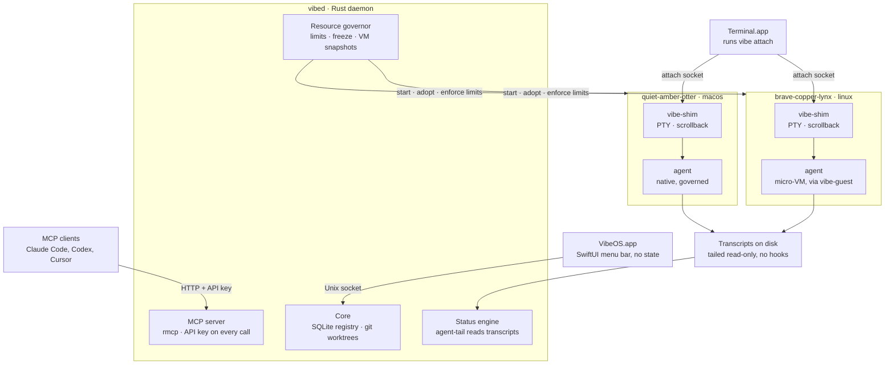
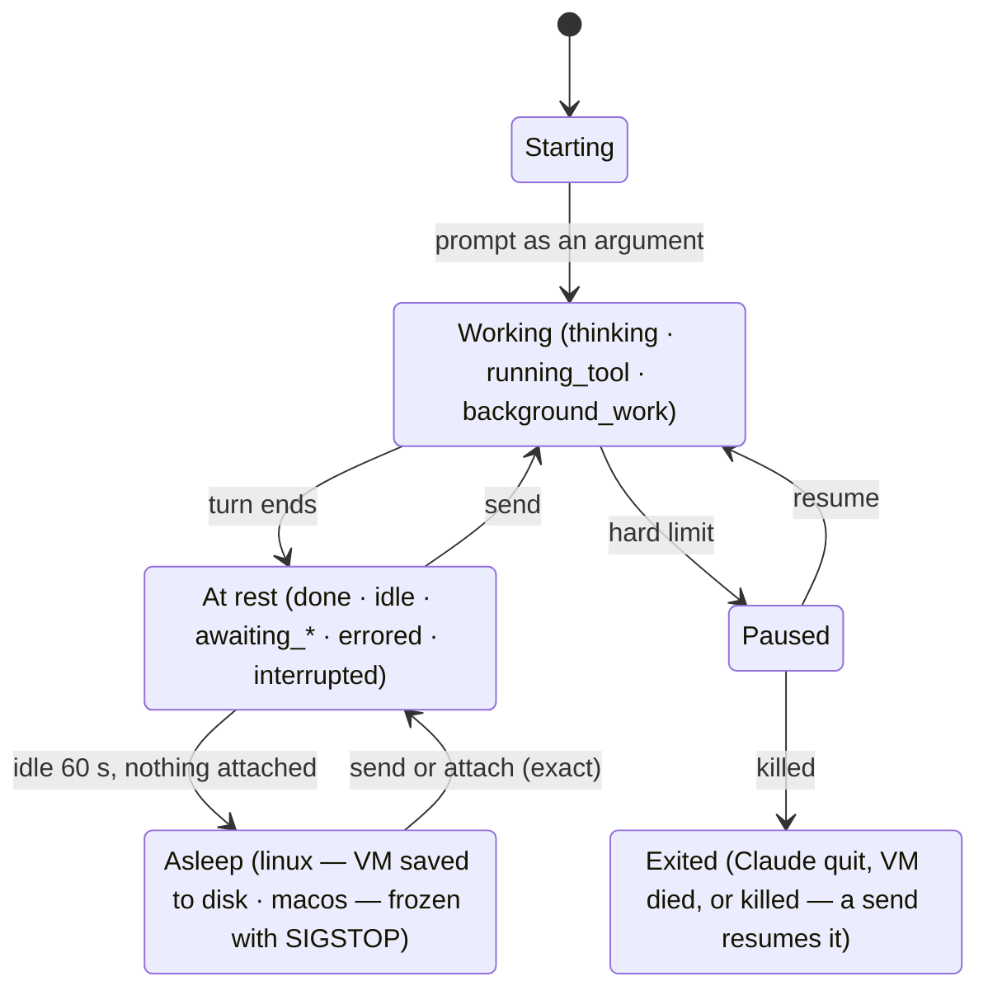

# VibeOS Native — Product Requirements

Oct 29, 2026 · @Lee

## Summary

VibeOS Native (repo: `vibe-os-native`) turns an always-on Apple Silicon Mac on the latest macOS into a private agent host. It has three parts: a Rust daemon, an MCP server and a SwiftUI menu bar app. Every agent gets its own git worktree and its own compartment. The agent's profile picks the compartment: a Linux micro-VM, or native macOS under a resource governor when the work needs a Mac.

The MCP server is the main interface. The menu bar lists the agents this app started, with live status. Clicking one opens Terminal.app attached to its session. Closing the window detaches; the agent keeps running.

Status comes from agent-tail, which reads Claude Code's own transcripts, so no hooks are needed. That's what lets the daemon put idle agents to sleep and give their resources back. VibeOS inspired the product, but there is no shared code and no compatibility promise.

## Goals and non-goals

v1 is one owner, one Mac, many agents. MCP matters most: the menu bar and Terminal are views onto what MCP drives. The menu shows only agents this app started, never other agent processes on the machine.

**Goals**

1. **MCP is the control plane, shaped like VibeOS's.** The round that already drives a working orchestrator stays: start an agent with a prompt, `vibe_wait`, read what it said, answer its questions with `vibe_send`. It's folded to one agent per worktree. Host setup (projects, profiles, the Linux template) lives in Settings.
2. **One agent, one worktree, one compartment.** Agents never share a checkout, because parallel work no longer needs sequencing inside one worktree.
3. **Profiles pick the environment.** Each project has a few profiles, such as `software-eng-linux` and `software-eng-mac`. A profile sets the environment, model, reasoning level, permission mode and memory. `linux` is a micro-VM; `macos` runs natively under a resource governor, for Xcode and other Mac toolchains.
4. **Many agents, one responsive host.** With 4 GB profiles, about 7 agents can be awake at once on a 32 GB Mac, and 15 on 64 GB. Asleep agents use no RAM, so many more can exist, limited only by disk. No compartment can starve macOS, the daemon or another agent.
5. **Know what every agent is doing without hooks.** agent-tail reads Claude Code's transcripts, and no Claude config is changed.
6. **Idle agents cost close to nothing and wake exactly where they were.** About a minute after agent-tail says an agent is at rest with nothing attached, a `linux` VM is paused and saved to disk, freeing all its RAM, and a `macos` agent is frozen. A send or an attach brings it back mid-prompt, even mid-question.
7. **No custom terminal.** Clicking an agent opens Terminal.app attached to the live session. Closing it detaches.
8. **Nothing is lost by accident.** Agents survive the menu bar app quitting, the daemon restarting or upgrading, and clients disconnecting. After a reboot they come back asleep. Deleting an agent with unsaved work is refused.
9. **Short setup.** About five minutes on a Mac where `gh` and `claude` are already logged in: add a project, keep or edit its two starter profiles, and log the Linux toolbox into `gh` once.

**Non-goals for v1**

- Harnesses other than Claude Code. agent-tail already reads seven more, so they can be added later.
- Several agents in one worktree.
- Reaching ports inside `linux` VMs (dev servers, previews). Agents test from inside their VM.
- A menu bar on any machine other than the host. Remote users drive agents over MCP and attach over SSH.
- A browser desktop, a custom terminal emulator, or terminals other than Terminal.app.
- File sandboxing for `macos` agents. They are trusted, and only resource-limited.
- Network egress filtering.
- Custom VM images or Dockerfiles. The Linux template covers customization.
- Multiple users or teams on one host.
- Shipping on a Linux host. The environment layer is built so it can be ported.
- Running macOS GUI apps or Xcode simulators inside `linux` VMs.
- Orchestration logic such as planning, queues or merge bots. Clients build that on top of MCP.
- A cloud relay. Remote access goes through Tailscale or SSH.

## Lineage: what VibeOS taught us

VibeOS proved out the ideas, so this product borrows them. Nothing else carries over: no code, no API compatibility, no shared users. The biggest lesson changes the model: agents work best isolated from each other. A VibeOS workspace with several windows becomes, here, one **agent** per **worktree**.

| Area | VibeOS (the inspiration) | This product |
| --- | --- | --- |
| Host | Debian/Ubuntu VPS | Apple Silicon Mac, always on |
| Language | Bun / TypeScript | Rust daemon + SwiftUI menu bar app |
| Primary UI | Browser desktop with xterm windows | Menu bar + Terminal.app |
| Unit of work | A workspace (worktree) holding several windows | One agent with its own worktree and compartment |
| Profiles | Harness, flags, standing prompt with blanks, colour | Environment, model, reasoning level, mode, memory |
| Session persistence | dtach, one socket per window | `vibe-shim`, one per agent (dtach-like, built in) |
| Attach | Browser SSH (WASM), or `ssh … vibe-os attach` | `vibe attach` over a Unix socket; `ssh -t host vibe attach` when remote |
| Agent status | Screen heuristics + Claude's session registry | agent-tail reading Claude Code's transcripts |
| Resource limits | systemd scope per window (`MemoryHigh` / `MemoryMax`) | Compartment per agent: Linux micro-VM or native macOS under a governor |
| Idle savings | Hibernate idle Claude windows after N minutes, then `--resume` | `linux` VMs saved to disk, `macos` agents frozen; both wake exactly where they were |
| Auth | Static bearer token + SSH CA | Mandatory API keys made in Settings |
| MCP | `vibe_*` tools over HTTP and stdio | The same round and semantics, folded to one agent per worktree |

**Ideas borrowed, reimplemented from scratch:** worktrees named with three random words, branching from `origin`'s default branch, `push.autoSetupRemote`, per-project profiles, the MCP round (a `vibe_wait` that waits for the reply to the last send, `keys` for menus), and the conservative idle rules.

## Core concepts

An agent, its worktree and its compartment are one unit. They're created together and deleted together, and one ref (e.g. `quiet-amber-otter`) names all three. The branch is the bare ref too, with no prefix.

| Term | Meaning | Lives at |
| --- | --- | --- |
| Host | The Mac running `vibed`. It has one owner. | — |
| Project | A GitHub repo cloned onto the host by `owner/name`, or a local repo registered by path. Added in Settings, where its profiles live too. | `~/VibeOS/projects/<name>` |
| Profile | A per-project preset for starting agents: environment, model, reasoning level, mode (`auto` or `bypass`) and memory. A new project starts with one per environment. | Settings → Projects (SQLite) |
| Agent | One Claude Code process and all its children, started from a profile, working in its own worktree inside its own compartment. | Process tree under a shim |
| Worktree | The agent's git worktree, on its own branch. Deleted with the agent; the branch is kept. | `~/VibeOS/worktrees/<project>/<ref>` |
| Compartment | The agent's isolation boundary: a micro-VM in `linux`, a governed process tree in `macos`. | — |
| Environment | `linux` or `macos`. Set by the profile, and fixed for the agent's life. | The profile |
| Linux template | The Linux machine every `linux` agent boots a copy of: whatever you install in the toolbox shell (`apt`, `curl … \| sh`, `npm -g`). Versioned. | Host disk image |
| Linux home | Logins and dotfiles every `linux` agent starts with (`gh`, `gcloud`, `~/.gitconfig`) and your Claude config (CLAUDE.md, settings, skills, MCP servers), all set up in the toolbox shell. Kept apart from the template so a rebuild doesn't lose them. | Host disk image |
| Managed layer | Tools the daemon keeps current for every `linux` VM. In v1 that's only Claude Code. | Host disk image |
| Toolbox shell | A Terminal session in a writable Linux VM, for changing the template and the Linux home. | Menu → Linux toolbox, or `vibe toolbox` |
| Host limits | Everything that isn't per profile: memory and cores kept for macOS, CPU cores per agent, process count, disk. | Settings → Host, or `~/.config/vibeos/host.toml` |
| Snapshot | A sleeping `linux` agent's whole VM, RAM included, saved to disk. Restoring it resumes the agent exactly. | `~/VibeOS/snapshots/<ref>` |
| Session | The PTY the agent runs in. A shim holds it, so it outlives every client. | `…/run/<ref>.sock` |
| Transcript | The session file Claude Code writes on its own. agent-tail reads it to get status. | `macos`: `~/.claude/projects/`; `linux`: the agent's Claude-home mount on the host |
| Client | Anything attached to an agent or calling `vibed`: Terminal via `vibe attach`, an MCP client, or the menu bar app. | — |

## Key user flows

An agent's life runs setup → start (worktree and compartment included) → work → sleep or attach → finish → delete. Every step works over MCP, and most also work from the menu.

1. **Install and setup.** Drag `VibeOS.app` into Applications. On first launch it registers `vibed` as a LaunchAgent (`SMAppService`), links `vibe` into `/usr/local/bin`, and runs a doctor checklist:
   - `gh auth status` and `gh auth setup-git`
   - git, the `claude` binary, and its login
   - Automation permission to control Terminal
   - power: auto-login, no system sleep
   - Tailscale (optional, for remote MCP)

   Meanwhile it downloads the Linux base image and the current Claude Code. Then it offers two last steps:
   - **Set up Linux.** Run `claude setup-token` on the Mac, and the daemon stores the long-lived token in Keychain. Then the toolbox shell opens in Terminal: run `gh auth login`, and anything else you want every Linux agent to have (`gcloud auth login`, `apt install …`, your Claude settings). Exit to save.
   - **Settings → API keys → New key**, with a ready `claude mcp add …` line to copy.
2. **Add a project.** Settings → Projects → Add takes a GitHub `owner/name`, cloned with the Mac's `gh` login into `~/VibeOS/projects/`, or a local path. The project starts with two profiles, one per environment (see Profiles), which you can edit or add to.
3. **Start an agent.** `vibe_start_agent {project, profile, prompt}`, or New agent… in the menu. One call does it all:
   - fetch `origin` and cut a worktree on a new branch from the default branch (or from `from`), with `push.autoSetupRemote` set
   - check admission against host headroom, using the profile's memory
   - create the compartment: boot the VM for `linux`, or set up the governed tree for `macos`
   - run the optional `.vibe/setup.sh` inside it
   - mark the worktree as trusted for Claude, start the shim, and launch `claude --session-id <uuid>` with the profile's model, reasoning level and mode. The prompt is an argument, never pasted, so a startup dialog can't swallow it.
   - agent-tail starts tailing the transcript
4. **Monitor.** The menu bar row shows state, title and the latest activity line. A notification fires when an agent has a question, errors or hits a limit. MCP clients use `vibe_wait`.
5. **Attach.** Click the row and Terminal.app opens running `vibe attach <ref>`. If a tab is already attached, that tab is raised instead. Closing the window detaches; the agent keeps running.
6. **Go idle.** About a minute after the agent comes to rest with nothing attached, it goes to sleep: a `linux` VM is saved to disk and its RAM freed, and a `macos` agent is frozen. A send or an attach wakes it exactly where it was, including mid-question.
7. **Finish.** The agent commits, pushes and opens a PR itself, in either environment. It uses the Mac's `gh` login in `macos`, and the Linux home's in `linux`.
8. **Delete.** `vibe_delete_agent` ends the agent and removes its worktree, compartment and snapshot. The branch is kept. Deletion is refused if there are uncommitted changes or unpushed commits, unless `force` is set. Nothing is deleted automatically.
9. **Reboot.** `vibed` starts at login and marks every agent `asleep`. A `linux` agent wakes from its snapshot, if snapshots survive a reboot (open question 1). A `macos` agent's processes are gone, so it wakes by continuing its conversation with `claude --resume`.

## Architecture

A Rust daemon owns all state and logic. Every other part is a thin client of it. Agents live in per-agent shims, so the daemon can restart or upgrade without killing any of them.

| Component | Language | Runs as | Job |
| --- | --- | --- | --- |
| `VibeOS.app` | SwiftUI (`MenuBarExtra`) | Login item | UI only, holds no state. Talks to `vibed` over a Unix socket. Quitting it changes nothing. |
| `vibed` | Rust | LaunchAgent (via `SMAppService`), as the logged-in user, no root | Registry (SQLite); worktree manager (shells out to `git`); agent supervisor; **status engine** (agent-tail); **resource governor** for `macos` agents; sleep and wake; Linux template, home and managed-layer builder; MCP server; event stream. |
| `vibe-shim` | Rust | One per awake agent, on the host, detached (its own session) | Owns the agent's terminal end: PTY (`macos`) or a vsock stream to `vibe-guest` (`linux`), a scrollback ring buffer, and a screen model (`vt100` crate) for `read_output` and redraw on attach. Serves `run/<ref>.sock`. |
| `vibe-vm` | Swift (Virtualization.framework) | One per awake `linux` agent, detached | Boots the agent's VM, or restores it from its snapshot. To sleep, it pauses the VM, saves its state to disk and exits. Holds the `com.apple.security.virtualization` entitlement. |
| `vibe-guest` | Rust, static Linux binary | PID 1 inside each VM | Starts Claude as the unprivileged user `vibe` on a PTY. Reports the process tree for the idle rules. After a restore, resets the clock. If the vsock link drops, Claude keeps running until the shim reconnects. |
| `vibe` CLI | Rust | On demand; linked into `/usr/local/bin` at setup | `vibe attach <ref>`, `vibe ls`, `vibe doctor`, `vibe toolbox`, and `vibe mcp` (a stdio bridge for clients that can only start a command). |

**Restarts.** Shims and `vibe-vm` processes are detached from `vibed`. A daemon crash or upgrade leaves every agent running, and on start `vibed` re-adopts them by scanning `run/`.

**One core, three doors.** The menu bar, the CLI and MCP all call the same core handlers inside `vibed` over JSON-RPC 2.0, so they can't drift apart. MCP is a façade on that core, built with `rmcp` (the official Rust MCP SDK).

**No Rust in the Swift processes.** The Swift app talks to `vibed` only through the socket. There is no UniFFI and no linked library, which keeps the Swift side small and the builds independent. `vibe-vm` is Swift too, because Virtualization.framework is an Apple API; it's a separate process that `vibed` drives over a pipe.

**Crates:** `vibe-core` (domain + store), `vibe-status` (wraps agent-tail), `vibe-env` (an `Environment` trait with `linux` and `macos` backends), `vibe-shim`, `vibe-guest`, `vibe-mcp`, `vibe-cli`.

**Status engine.** It wraps agent-tail's `SessionReducer`. `vibed` matches each agent to its transcript and feeds in the bytes as they're appended (details under State and lifecycle). The shim's screen model is a fallback only, for the rare moment a transcript can't be found.



`vibed` sets up an attach: it finds the agent and wakes it if needed. After that, Terminal's bytes flow straight to the shim, so a daemon restart doesn't interrupt an attached session.

## Environments and profiles

Every agent runs in its own compartment, in the environment its profile names. `linux` is a micro-VM with hard limits and its own kernel. `macos` runs natively under `vibed`'s resource governor, for work that needs Xcode, Swift or other Mac-only toolchains.

| Environment | How it runs | Enforces | Sleeps by | Pick it for | Logins and binaries | Trust |
| --- | --- | --- | --- | --- | --- | --- |
| `linux` | Micro-VM per agent on Apple's Virtualization.framework | vCPUs and RAM fixed at boot; separate kernel and filesystem | Saving the VM to disk: RAM freed, exact restore | Most work: web, backend, CLIs, anything that builds on Linux | The Linux toolchain and home, plus Claude's long-lived token | Isolated from the host and from other agents |
| `macos` | Native processes under `vibed`'s governor | CPU, memory, process count and disk, by supervision | `SIGSTOP`: exact; macOS compresses or swaps the memory | iOS and macOS apps, Xcode, Swift, Homebrew-only tools | The Mac's own binaries and logins, as you | Runs as you, with no file sandbox: the governor protects the machine's resources, not your files |

### Profiles

A profile is everything you choose when starting an agent, saved under a name. Profiles belong to a project and are edited in Settings → Projects. A new project starts with these two:

| Profile | Environment | Model | Reasoning | Mode | Memory |
| --- | --- | --- | --- | --- | --- |
| `software-eng-linux` | `linux` | Opus | high | auto | 4 GB |
| `software-eng-mac` | `macos` | Opus | high | auto | 4 GB |

- **Model:** Opus or Sonnet (`--model`).
- **Reasoning:** Claude's effort level (`--effort`).
- **Mode:** `auto` by default, or `bypass` (`--dangerously-skip-permissions`), in either environment. Bypass on `macos` is the owner's call.
- **Memory:** the agent's high-water mark: a `linux` VM's fixed RAM, or a `macos` agent's hard limit.

MCP clients see each project's profiles in `vibe_list_projects` and pass one by name to `vibe_start_agent`. An agent can't change profile or environment; start a new one `from` the same branch instead.

### Host limits

Everything that isn't per profile is host-wide, in Settings → Host or `~/.config/vibeos/host.toml`. Every number is a proposed default to check on real hardware:

```toml
reserve_memory   = "4G"    # always left for macOS and vibed
reserve_cores    = 2
max_awake_agents = 16
cpu_cores        = 4       # per agent
max_processes    = 512     # per macos agent
disk_soft        = "20G"   # per worktree
disk_hard        = "30G"
vm_disk          = "20G"   # a linux agent's own writable layer
idle_debounce    = "60s"
snapshot_disk    = "20G"   # total for all sleeping linux agents
```

Admission reserves the profile's memory for each awake agent. If host headroom minus the reserve can't cover a new agent, agents still inside their idle debounce go to sleep early, oldest first. If there's still no room, the start is refused with a clear reason. Starts never queue.

### How `macos` is governed

macOS has no cgroups, so `vibed` supervises each `macos` agent's process tree and acts on it. There is deliberately no file sandbox, so Xcode, SwiftPM, simulators and Homebrew all work. The levers below are listed mildest first.

- **Membership.** Every process inherits `VIBE_COMPARTMENT=<id>` and the shim's session. The governor walks the tree every second (`proc_listchildpids`). Every 5 s it also scans the user's processes for the tag (`KERN_PROCARGS2`), which catches daemons that got reparented to launchd. Services that launchd starts on an agent's behalf, like simulators and Xcode build services, aren't counted.
- **CPU.** The cap is in cores, measured from CPU-time deltas. Over the cap, the agent is first demoted to `PRIO_DARWIN_BG`: efficiency cores and throttled I/O, enforced by the kernel. If it's still over, `SIGSTOP`/`SIGCONT` duty cycling holds it to the cap.
- **Memory.** The governor sums `phys_footprint` (`proc_pid_rusage`). At 80% of the profile's memory, the agent is demoted and a notification fires. At 100%, the tree gets `SIGSTOP` and the agent is `paused`. The owner can raise the profile's memory and resume it, or delete it.
- **Processes.** Over `max_processes`, the tree is paused. This is the fork-bomb stop.
- **Disk.** The worktree and its temp dir are measured every minute. Past `disk_soft` a warning fires; past `disk_hard` the tree is paused.
- **Logins and binaries.** `macos` agents use the Mac's own `claude`, `gh`, `gcloud` and Keychain logins. Nothing is redirected.

### What's inside `linux`

A `linux` agent boots a stack of layers. You build the middle once, the daemon keeps the rest current, and the agent writes only to its own copy.

```
agent VM = base image      ships with the app: Debian slim, git, gh, curl,
                           ripgrep, jq, build-essential, Python 3, Node LTS, mise
         + Linux template  what you installed in the toolbox shell   read-only
         + managed layer   Claude Code, updated daily by the daemon  read-only, first on PATH
         + Linux home      your logins and dotfiles                  read-only
         + agent's copy    everything this agent writes              discarded on delete
```

#### The toolbox shell

Menu → Linux toolbox → Open shell (or `vibe toolbox`) opens Terminal in a VM where the template and the Linux home are writable. Install any way you like (`apt install`, `curl … | sh`, `npm -g`) and log in to whatever you need. Exiting saves a new version of each. New agents boot the latest versions; running agents keep theirs until their next boot. Only one toolbox shell can be open at a time, and agents never change the template or the home.

`~/.config/vibeos/toolbox.toml` is optional. It's a recipe the daemon can replay into a fresh template, plus update commands to run on a schedule:

```toml
packages = ["kubectl", "postgresql-client"]   # apt

[[install]]
name = "gcloud"
run  = "curl -sSL https://sdk.cloud.google.com | bash -s -- --disable-prompts --install-dir=/opt"

[update]   # run weekly in a toolbox VM; the result is saved as a new template version
run = ["gcloud components update --quiet"]
```

**Base image updates.** A new app release can ship a new base image, but the daemon never swaps it under your template. Instead the menu offers **Rebuild template**. That boots the new base, replays `toolbox.toml`, and lists anything you installed by hand that the recipe doesn't cover. The Linux home carries over unchanged.

Repos don't customize the VM themselves. Project dependencies go in `.vibe/setup.sh`, which runs in every new agent in both environments.

#### Exceptions to “set up once, then frozen”

| What | Why the frozen template doesn't fit | How it works instead |
| --- | --- | --- |
| Claude Code | It must stay current | The managed layer: the daemon downloads each new release into a new layer version. Claude's own auto-updater is off inside VMs |
| Claude's login | A refreshed OAuth token inside one agent's copy could leave the shared home holding a dead one | A long-lived token from `claude setup-token`, kept in the Mac's Keychain and injected as `CLAUDE_CODE_OAUTH_TOKEN` |
| Other self-updating CLIs (`gcloud`, `gh`) | An update inside an agent lands in that agent's throwaway copy | The `[update]` commands in `toolbox.toml`, or updating by hand in the toolbox shell |
| Shared, writable state | Can't be a read-only layer | Read-write mounts (below) |

#### Mounts

Mounts are the same for every agent:

- **The worktree**, read-write, at the same absolute path as on the host.
- **The project's `.git` directory**, read-write, at its host path. A worktree's `.git` file points into it. Git's lock files handle concurrent ref updates from several VMs. Agents run with `gc.auto=0`, and the daemon runs `git maintenance` on the host during quiet periods.
- **The agent's Claude home**, a per-agent host directory mounted as `~/.claude`. When the agent starts, it's seeded with a copy of the Linux home's Claude config (CLAUDE.md, settings, skills, agents, commands), which you set up in the toolbox shell like any login. agent-tail reads transcripts from it on the host, and `claude --resume` finds them after a crash or reboot.
- **Shared package caches** (npm, pnpm, cargo, pip), read-write.

#### Sleep and wake

The VM boots with its agent. When the agent goes idle, `vibe-vm` pauses the VM, saves its whole state (RAM and devices) to the agent's snapshot file and exits, so all its RAM goes back to the Mac. Waking restores the snapshot: Claude is exactly where it was, mid-prompt or mid-question, with nothing replayed. `vibe-guest` then resets the clock and the shim reconnects. Network connections open at sleep time are dropped; an idle Claude has none in flight (open question 5 checks this).

All snapshots share one disk budget, `snapshot_disk`: 20 GB by default, adjustable in Settings → Host. When a new snapshot wouldn't fit, the oldest snapshot is dropped, and that agent wakes later with `claude --resume` instead, losing any pending question.

## MCP interface

MCP is the product. It keeps the shape of VibeOS's MCP, which already drives a working orchestrator: start an agent with a prompt, `vibe_wait`, read what it said, and answer its questions with `vibe_send`. Where VibeOS split one job across a workspace and its windows, this server has one tool, because each worktree has exactly one agent. Every call needs an API key. Host setup (API keys, projects, profiles, host limits, the Linux template) is menu-only.

**Transport.** Streamable HTTP at `http://127.0.0.1:7878/mcp` (port to be decided). The Tailscale interface can be turned on in Settings. There's also stdio through `vibe mcp` for clients that can only launch a command. Built with `rmcp`.

**Auth is always on.** There's no unauthenticated mode, not even on loopback.

- **Settings → API keys** generates a key (`vk_…`, 256 bits) with a name such as "laptop Claude Code". The key is shown with **Copy** and **Copy setup command** buttons.
- Keys are stored hashed. Each one can be revoked and shows when it was last used.
- Clients send `Authorization: Bearer <key>`.
- A key is equivalent to a shell on the Mac, and the Settings screen says so.

| Tool | Does | From VibeOS |
| --- | --- | --- |
| `vibe_list_projects` | Projects, each with its profiles: name, environment, model, reasoning, mode, memory | Same tool; profile fields changed |
| `vibe_start_agent` | `{project, profile, prompt, from?: branch, name?}` → ref. Creates the worktree, branch, compartment and agent in one call, and submits the prompt | Replaces `vibe_create_workspace` + `vibe_open_window` |
| `vibe_list_agents` | Agents with their state, activity, profile, worktree path, branch, live memory and attach command. Filters: `project`, `state` | Replaces `vibe_list_workspaces` + `vibe_list_windows` |
| `vibe_send` | `text`, submitted unless `submit: false`, or `keys` (`["2"]`, `["Escape"]`, `["Down", "Enter"]`). Wakes a sleeping or exited agent first | Same |
| `vibe_wait` | Blocks until an agent, or the first of several, answers the last send, not just until it's quiet. `background: true` also waits for commands it left running. Progress every 20 s and on every change; up to 240 s, default 120 | Same |
| `vibe_read_messages` | The agent's last messages, from its transcript | Same |
| `vibe_read_output` | The screen, plus what scrolled into history since an `after` cursor | Same |
| `vibe_delete_agent` | Ends the agent and removes its worktree, compartment and snapshot. Keeps the branch. Refuses on uncommitted changes or unpushed commits unless `force` | Replaces `vibe_close_window` + `vibe_delete_workspace` |

**States.** As in VibeOS, an agent is `busy`, `idle`, `question` or `asleep`, plus `paused` (a limit hit) and `exited`. `question` covers any prompt waiting on an answer: a menu, a yes/no, a permission prompt. agent-tail's finer `activity` (`thinking`, `running_tool`, `awaiting_approval`, …) rides along for clients that want it. Frozen and saved-to-disk agents both show as `asleep`, because a send wakes either.

**Rules carried over.** Reads (`vibe_wait`, `vibe_read_*`, `vibe_list_*`) never wake an agent; `vibe_send` does. Text results are cut at about 32,000 characters, keeping the end, with a note saying how much was cut. MCP Resources and Tasks aren't used in v1. Events reach the menu bar over the socket, and MCP clients through `vibe_wait`.

## Menu bar and Terminal attach

The menu bar lists every agent this app started, across all projects, and nothing else. Clicking a row gives you that agent's raw terminal in Terminal.app.

**Menu bar icon.** A glyph plus the count of awake agents. It gets an amber dot when any agent has a question, and a red dot when one is paused by a limit.

**The menu** (`MenuBarExtra`, window style, so rows can be rich):

- **Header:** agent count, host memory used/total, `gh` login state, MCP on/off.
- **Agent rows,** grouped by project, each tagged with its profile. Each row shows:
  - a state dot: busy (pulsing), question (amber), idle (grey), asleep (hollow), paused or exited (red)
  - the label or ref
  - the session title from the transcript, and the latest activity line
  - elapsed time and a memory bar against the profile's limit
- **Click** a row to attach in Terminal. **Right-click** for: Interrupt, Reveal worktree in Finder, Open in editor, Copy attach command, Delete agent.
- **Footer:**
  - New agent… (a small sheet: project, profile, prompt)
  - Linux toolbox (open shell, rebuild template, see logins)
  - Settings… (API keys, projects and their profiles, host limits)
  - Quit menu. This leaves `vibed` and every agent running.

**Notifications** fire on a question, an error, a limit hit, and the end of a turn (off by default). Clicking one attaches.

### How a click becomes a Terminal window

1. The app asks `vibed` to attach `<ref>`, and `vibed` wakes the agent if it's frozen or asleep. If a `vibe attach` client for that ref is already running in Terminal, `vibed` knows its tty, so the app raises that tab with AppleScript and stops here.
2. Otherwise the app runs, through `NSAppleScript`: `tell application "Terminal" to do script "exec /usr/local/bin/vibe attach quiet-amber-otter"`, then `activate`. The first time, macOS asks for Automation permission.
3. If that permission is denied, the app writes a `.command` file and runs `open` on it, which needs no permission.
4. `vibe attach`:
   - puts the tty in raw mode and connects to the shim's socket
   - redraws the screen from the shim's screen model, then streams
   - forwards resizes and sets the window title (e.g. `quiet-amber-otter · reviewer`)
5. Closing the window detaches. So does the detach key (`Ctrl-\`, as in dtach). Several clients can attach at once; the last one active sets the size.

**From another machine.** `ssh -t mac-mini vibe attach <ref>` works in any terminal; each agent in `vibe_list_agents` carries that line. The menu bar itself runs only on the host.

## Auth, security and trust

An API key is a shell on the Mac, so keys are mandatory and the server listens on loopback by default. Logins follow one rule: a `macos` agent uses the Mac's own logins, and a `linux` agent uses the Linux home, which the owner sets up once.

- **No root.** `vibed` runs as the logged-in user. v1 has no privileged helper.
- **Distribution.** Open source under MIT, in a public repo. Releases are a DMG signed with the owner's existing Developer ID and notarized and a Homebrew cask, with Sparkle for updates. Not the Mac App Store, whose sandbox blocks most of this. `vibe-vm` carries the `com.apple.security.virtualization` entitlement.
- **Network exposure.** Loopback by default. Settings can also bind the Tailscale address. Never `0.0.0.0`. Public exposure (e.g. Tailscale Funnel) is the user's own choice and is documented, not built in.
- **GitHub.** `vibed` checks `gh auth status` at startup and every hour, and the menu header shows the result. Worktrees fetch through `gh` as git's credential helper.

**Who gets which credentials:**

| Environment | GitHub, gcloud and other logins | Claude | Set up by |
| --- | --- | --- | --- |
| `macos` | The Mac's own: `gh` as git's credential helper, `~/.config/gcloud` and so on | The Mac's Claude login in Keychain | Logging in on the Mac as yourself, as you already do |
| `linux` | The Linux home: read-only in every VM, with a per-agent copy on top | A long-lived `claude setup-token` token, kept in Keychain and injected as `CLAUDE_CODE_OAUTH_TOKEN` | One toolbox-shell session, plus `claude setup-token` once |

**Threat model, plainly:**

- `macos` protects the machine's resources: runaway builds, fork bombs, memory leaks. It does not protect your files. A `macos` agent can do anything you can.
- `linux` protects the host and other agents from a misbehaving agent. It does not protect the Linux home's logins: any agent can use them, and a compromised agent could copy them. For tighter scope, log the Linux home's `gh` into a fine-grained token rather than your full account. Network egress is open.
- Every agent can write to the project's shared `.git`, so a misbehaving agent could rewrite other branches' refs. Pushed branches on GitHub are the backstop.
- Nothing protects against a stolen API key except revoking it.

**Permissions.** Each profile sets Claude's mode: `auto` (the default), or `bypass` (`--dangerously-skip-permissions`). Bypass is safest in `linux`, where the VM is the sandbox. A `macos` profile can use it too; that agent then acts as you without asking, which is the owner's call.

Transcripts, scrollback and logs never leave the Mac. Logs redact keys and tokens.

## State, lifecycle and failure handling

agent-tail decides what an agent is doing, and `vibed` decides what happens to its process. An agent at rest with nobody watching goes to sleep on its own, with no hooks and no long timeout. agent-tail's firm states say when it's truly idle, and after a 60 s debounce a `linux` agent is saved to disk and a `macos` agent is frozen. Either way it wakes exactly where it was.



Working and At rest come straight from agent-tail's `activity`. Sleeping, pausing and waking are `vibed`'s decisions, made from that activity plus who is attached. MCP clients see the same lifecycle as the states `busy`, `idle`, `question`, `asleep`, `paused` and `exited`.

### Matching an agent to its transcript

Only transcripts of agents this app spawned are read. agent-tail is fed specific files, never a scan of the whole home folder.

- **By id.** Claude Code is launched with `--session-id <uuid>` generated by `vibed`, so the transcript path is known exactly. `--resume` keeps the same id.
- **By worktree.** If `/clear` changes the id, `vibed` takes the newest session whose recorded cwd is the agent's worktree. Each worktree has exactly one agent, so this is always exact.
- **Where.** `macos` transcripts are in the Mac's normal `~/.claude/projects/`. `linux` transcripts are in the agent's Claude-home mount, which is a host directory, so tailing works the same way.
- **Polling.** Each agent's reducer gets appended bytes on every file-system event, plus a 1 s poll as a backstop. `vibed` passes `now` in, as the library expects, and sets agent-tail's idle window to the idle debounce.

### Going to sleep

**Idle** means all of these hold:

- agent-tail reports a *firm* `done`, `interrupted`, `errored`, `awaiting_answer` or `awaiting_approval`. Its firm states already rule out subagents and background tasks, which show as `background_work`, so no timing guess is needed. An agent stopped by a Claude usage limit counts as at rest too: it sleeps like any other, and the next send wakes it.
- no process in the tree that agent-tail can't see: nothing started more than 30 s after Claude, other than the MCP servers Claude starts. This catches detached jobs such as `nohup` or a container. In `linux`, `vibe-guest` reports the tree.
- no pending scheduled wakeup (`/loop`, `ScheduleWakeup`, `CronCreate`), which wouldn't fire while asleep. Until [agent-tail#120](https://github.com/tsconfigdotjson/agent-tail/issues/120) can see these, `vibed` treats any such call in the transcript as keeping the agent awake for the rest of the session.
- no client is attached
- the agent has stayed idle for the debounce, 60 s by default. This absorbs the usual MCP loop of `vibe_wait`, then read, then the next send, so each turn doesn't pay a wake. It can be set to 0.

| Environment | Sleep | Cost while asleep | Wake |
| --- | --- | --- | --- |
| `linux` | `vibe-vm` pauses the VM, writes its state to the snapshot file and exits. The shim exits too | Disk, up to the VM's RAM. No RAM, no CPU | Restore the snapshot and start a shim. Exact, in a few seconds (to measure) |
| `macos` | `SIGSTOP` the whole tree | No CPU. Memory stays allocated, and macOS compresses or swaps it under pressure | `SIGCONT`. Exact and instant |

Wake triggers are `vibe_send` and attach. Reading doesn't wake an agent: transcripts are on the host, so `vibe_read_messages` and the menu rows work while it sleeps, and `vibe_read_output` returns the last saved screen.

Never put to sleep: `thinking`, `running_tool`, `background_work`, and any *inferred* awaiting state. `claude --resume` is used only when an agent's processes are gone: after a crash, after a reboot in `macos`, or when a `macos` agent is killed under critical memory pressure. Resuming that way loses a pending question.

### Failures

| Event | Behaviour |
| --- | --- |
| Menu bar app quits or crashes | Nothing changes. On relaunch it reconnects to `vibed` |
| `vibed` crashes or upgrades | launchd restarts it. It re-adopts shims and VMs from `run/` and rebuilds agent-tail state from each transcript. Agents keep running |
| A shim dies | `macos`: it leads the agent's session, so the tree gets `SIGHUP` and the agent becomes `exited`. `linux`: Claude keeps running in the VM; `vibed` starts a new shim, which reconnects to `vibe-guest` |
| A VM dies | The agent becomes `exited`. Its transcript is on the host, so a send resumes it with `claude --resume` |
| A snapshot won't restore | The snapshot is discarded and the agent resumes with `claude --resume` in a fresh VM. Its state notes that any pending question was lost |
| Claude exits on its own | `exited`, with its code. Attached clients print the reason and close. A send resumes it |
| Reboot or logout | Every process ends. At login every agent is `asleep`. `linux` agents wake from their snapshots; `macos` agents wake with `claude --resume` |
| Critical host memory pressure (`DISPATCH_SOURCE_TYPE_MEMORYPRESSURE`) | Refuse new agents, put idle agents to sleep early, then pause the `macos` agent furthest over 80% of its memory. A paused agent is killed (resumable) after a 5 min grace period if pressure stays critical |
| System sleep | While any agent is awake, `vibed` holds an IOPM no-idle-sleep assertion. Display sleep is still allowed |
| Low disk | New agents are refused below 10 GB free (proposed). A `linux` agent whose snapshot wouldn't fit stays awake instead of sleeping |

**Where state lives:**

- SQLite at `~/Library/Application Support/VibeOS/vibe.db`: projects, profiles, worktrees, agents (ref, profile, shim socket, Claude session id, worktree, last state), API key hashes
- snapshots in `~/VibeOS/snapshots/`
- logs in `~/Library/Logs/VibeOS/`
- sockets in `…/VibeOS/run/`

## Open questions

Three of these block design work: VM snapshots, how the layers stack, and the headless-reboot story. The rest have a recommended answer that can be confirmed later.

| # | Question | Recommendation | Why |
| --- | --- | --- | --- |
| 1 | Does Virtualization.framework's save and restore work for our VMs? | A one-week spike. Test it with virtio-fs shares and vsock attached. Measure restore time and snapshot size for a 4 GB VM, and whether a snapshot grows with the RAM the guest used or is always the full 4 GB. Check that a snapshot survives a reboot, and that the guest doesn't see stale files in the shared `.git` after a restore. Also check whether Apple Containerization exposes snapshots | Snapshots make sleep exact and free. If they fall short, stop and decide with the owner before picking a fallback: libkrun with `claude --resume` (which loses pending questions), or Containerization |
| 2 | How do the template, managed layer, home and agent copy stack? | Read-only disk images plus a per-agent writable image, combined with overlayfs inside the guest. Never overlayfs on top of virtio-fs | Block images are stable and versionable. Overlayfs over a shared filesystem is fragile |
| 3 | How does a headless Mac come back after a reboot? A LaunchAgent needs a logged-in user | v1 requires auto-login, and the doctor checks for it. macOS turns auto-login off when FileVault is on, so this means FileVault off, or a manual unlock after each reboot. Parked for now. A LaunchDaemon mode comes later | A Mac mini in a closet will reboot for updates |
| 4 | Are 4 GB starter profiles right? | Measure real Claude sessions with typical builds on 32 GB and 64 GB machines | Every number here is a guess until measured |
| 5 | Does Claude Code wake cleanly from `SIGCONT`, and from a VM restore with dropped connections and a jumped clock? | Add both scenarios to agent-tail's harness CI | Sleeping is only safe if waking always works |
| 6 | Does a `claude setup-token` token cover everything Claude needs inside a VM? | Verify it during the VM spike | It's the one credential every `linux` agent depends on |
| 7 | How to depend on agent-tail, which isn't on crates.io | Use a git tag pinned to the frozen v0.1 status model | Stable contract, no publishing work yet |
| 8 | Shared package caches across `linux` VMs | Share them by default, with an opt-out | Speed matters more than cache poisoning for one owner |
| 9 | Which harness comes after Claude Code? | Codex, added as a profile field | It's CI-verified in agent-tail and can resume |
| 10 | Linux hosts | Later: the same `vibed` on a Linux host, offering only `linux`, on a KVM VMM with snapshots (Firecracker or Cloud Hypervisor) | The `Environment` trait is built for it from day one |

**Decided on 2026-10-29:**

- The menu bar runs on the host only, and shows only agents this app started. Remote users use MCP and `ssh -t host vibe attach`.
- One agent per worktree, each with its own compartment and, in `linux`, its own VM.
- The product is VibeOS Native, in the `vibe-os-native` repo. It targets the latest macOS only. Inside the product, names stay short: `VibeOS.app`, `~/VibeOS/`, `~/.config/vibeos/`.
- Releases are signed and notarized with the owner's existing Apple Developer account.
- Agent branches are the bare ref (`quiet-amber-otter`), with no prefix.
- Any profile may use `bypass`, including `macos`; that's the owner's call.
- Profiles belong to projects and set environment, model, reasoning level, mode (`auto` or `bypass`) and memory. Each new project starts with a `linux` and a `macos` profile: Opus, high reasoning, `auto`, 4 GB.
- `macos` agents use the Mac's own binaries and logins, and are resource-governed only, with no file sandbox.
- `linux` agents use the Linux template and home set up in the toolbox shell, including Claude config. Claude Code comes from a daemon-managed layer updated daily, and authenticates with a `setup-token` token.
- The MCP keeps VibeOS's round and semantics, folded to one agent per worktree: eight tools.
- Idle is decided by agent-tail's firm states plus a process-tree check and a 60 s debounce. `linux` agents sleep by saving the VM to disk, `macos` agents by `SIGSTOP`, and both wake exactly where they were. `claude --resume` is only for crashes, reboots and dropped snapshots.
- Sleeping `linux` agents share one snapshot budget, 20 GB by default and adjustable; past it, the oldest snapshot is dropped.
- An agent stopped by a Claude usage limit sleeps like any idle agent.
- If VM snapshots fail the spike, work pauses for a decision before any fallback is chosen.
- Agents share the project's `.git`, with auto-gc off and maintenance run by the daemon.
- Agents push and open PRs themselves, in both environments.
- v1 supports Claude Code only.
- MCP always requires an API key, generated in Settings.
- Projects are added in Settings, from GitHub `owner/name` or a local path.
- A full host puts idle agents to sleep first, then refuses. Starts never queue.
- Cleanup is manual. Deletion refuses on uncommitted or unpushed work unless forced.
- Not in v1: egress filtering, port forwarding, terminals other than Terminal.app, custom VM images, token cost in the menu.
- Open source under MIT.
