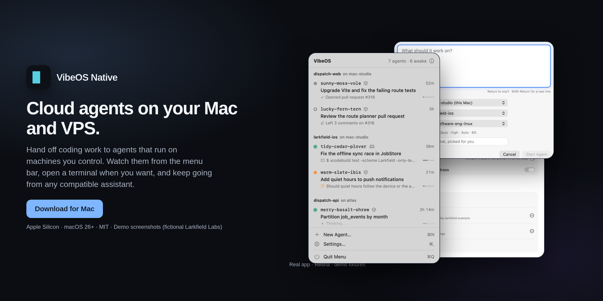

  

<h1 align="center">VibeOS Native</h1>

<strong>Cloud agents on your Mac and VPS.</strong>

  Hand coding work to agents that run on machines you control. 
  Watch them from the menu bar, open a terminal when you want, and keep going.

  <a href="https://github.com/tsconfigdotjson/vibe-os-native/releases/latest"><strong>Download for Mac</strong></a>
  &nbsp;·&nbsp; Apple Silicon · macOS 26 or later · <a href="LICENSE">MIT</a>

  

Hero and screenshots show the real app on a fictional demo workspace (Larkfield Labs).

## What you get

**Agents on machines you control.** Run them on your Mac and on Linux servers you add — including a rented VPS. No VibeOS cloud in the middle.

**A terminal when you want one.** Click an agent and Terminal opens on its live session. Step away; come back; the work is still there.

**Progress at a glance.** The menu bar shows what each agent is doing and when it needs you.

**Your assistant can drive them too.** Compatible assistants can start agents and check in on them. Setup details are in the docs if you want that path.

## Get started

1. **[Download the latest release](https://github.com/tsconfigdotjson/vibe-os-native/releases/latest)** and open the DMG.
2. Drag VibeOS into Applications and launch it. Follow the welcome checklist.
3. Add a project, then start an agent from **New Agent…** in the menu.

Connecting an assistant is optional — see [MCP and networking](docs/mcp-and-networking.md) when you're ready.

## Keep in mind

A sleeping Mac pauses the agents on it. A Linux server can keep its own agents going while the Mac is away.

## Learn more

- [MCP and networking](docs/mcp-and-networking.md)
- [Developing VibeOS](docs/development.md)
- [PRD.md](PRD.md) · [Contributing](CONTRIBUTING.md) · [Issues](https://github.com/tsconfigdotjson/vibe-os-native/issues)

Released under the [MIT License](LICENSE).
