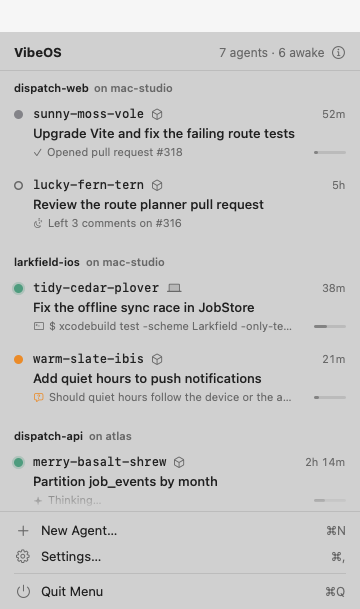
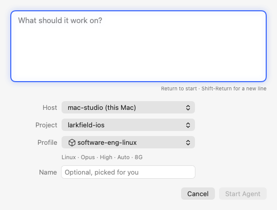
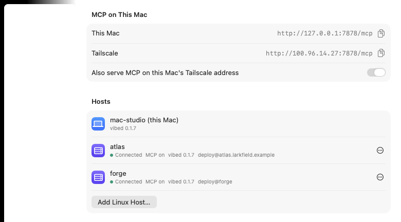

<p align="center">
  
</p>

<h1 align="center">VibeOS Native</h1>

<p align="center"><strong>Cloud-agent workflows on machines you control.</strong></p>

<p align="center">
  Hand coding agents a prompt, let them work in the background, and step in when they need you.<br>
  They run on your own Mac and Linux servers, driven over MCP and watched from the menu bar.
</p>

<p align="center">
  <a href="https://github.com/tsconfigdotjson/vibe-os-native/releases/latest"><strong>Download for Mac</strong></a>
  &nbsp;·&nbsp; Apple Silicon, macOS 26 or later &nbsp;·&nbsp; Free and open source
</p>

<p align="center">
  <picture>
    <source media="(prefers-color-scheme: dark)" srcset="docs/images/menu-dark.png">
    
  </picture>
</p>

<p align="center"><sub>Screenshots show the real app's windows on a fictional demo workspace.</sub></p>

## Why VibeOS

- **Hand off work from any MCP client.** Claude Code on your laptop, or an orchestrator of your own, can start an agent with a prompt, wait for it, read what it said and answer its questions.
- **Give every agent its own space.** Each one gets its own git worktree and branch, inside its own compartment, so parallel work doesn't collide. On the Mac that's a Linux micro-VM, or a native macOS process under resource limits when the work needs Xcode. On a Linux server it's a cgroup.
- **Open a real terminal whenever you like.** Click an agent and Terminal.app opens attached to its live session, ready for you to type.
- **Reconnect without losing the session.** Close the window, drop your SSH connection or quit the menu bar app, and the agent keeps running. Attach again and its screen comes back. It also carries on through a `vibed` restart or upgrade.
- **Bring your Linux servers into the same menu.** Add a server by its SSH destination and VibeOS installs itself there. Its agents appear beside your Mac's, in the menu and over MCP.
- **Let idle agents give back resources.** About a minute after an agent comes to rest with nothing attached, it goes to sleep. A Linux VM on the Mac is saved to disk, freeing its RAM. Other agents are frozen. A message or an attach wakes it where it left off.
- **Hear about it when you're needed.** The menu shows what each agent is doing, and a notification fires when one has a question, hits an error or reaches a limit.

Agents run [Claude Code](https://claude.com/product/claude-code) or [Pi](https://github.com/earendil-works/pi), with your own logins.

> [!NOTE]
> A reboot ends running processes, and agents come back asleep. A Linux VM on the Mac that was saved to disk wakes right where it was. Other agents wake by resuming their conversation in a new process, so anything else they had running is gone. Critical memory pressure can end an agent the same way.

## Get started

**[Download the latest release](https://github.com/tsconfigdotjson/vibe-os-native/releases/latest)**, then:

1. **Install.** Open the DMG, drag VibeOS into Applications and open it from there. The app is signed and notarized, and updates itself.
2. **Follow the welcome.** The menu bar lists what's left, in order. VibeOS sets up what it can by itself and asks only for what needs you, such as signing in to GitHub and Claude.
3. **Add a project.** Pick a GitHub repo or a folder on your Mac. It comes with two starter profiles, one for each environment.
4. **Make an API key.** Go to **Settings → API Keys**, which gives you a setup line to copy:

   ```sh
   claude mcp add --transport http vibeos http://127.0.0.1:7878/mcp --header "Authorization: Bearer vk_…"
   ```

5. **Start an agent.** Ask your MCP client, or choose **New Agent…** in the menu:

   > Use vibeos to start an agent on my-app that fixes the flaky login test, and tell me if it has a question.

<p align="center">
  <picture>
    <source media="(prefers-color-scheme: dark)" srcset="docs/images/new-agent-dark.png">
    
  </picture>
</p>

## Connect your machines

MCP always needs an API key, and it starts out on loopback only. From there, add what you need:

| You want to | Use | You'll need |
| --- | --- | --- |
| Drive agents from the same machine | `http://127.0.0.1:7878/mcp` | An API key |
| Run agents on a Linux server | **Settings → Hosts → Add Linux Host…** | Key-based SSH to the server. Tailscale isn't required, though a Tailscale name works as the destination |
| Reach MCP from your laptop or another machine | **Settings → Hosts → Also serve MCP on this Mac's Tailscale address** | Tailscale running and logged in on both machines, and access rules that allow it |

We suggest [Tailscale](https://tailscale.com) if you want other machines to reach MCP, but it's optional. VibeOS doesn't install or configure it, and the Mac never listens on all interfaces.

A Linux server doesn't depend on the Mac. With the Mac off, its agents keep running and it serves its own MCP on its own loopback address, and you can still attach with `ssh -t HOST vibe attach REF`. The Mac's own agents are unavailable until it's back.

[MCP and networking](docs/mcp-and-networking.md) covers each path and its limits.

<p align="center">
  <picture>
    <source media="(prefers-color-scheme: dark)" srcset="docs/images/settings-hosts-dark.png">
    
  </picture>
</p>

## Requirements

- **A Mac** with Apple Silicon and macOS 26 or later. Agents on it stop answering while it sleeps, so one that stays awake works best.
- **Your own accounts**, such as GitHub, and Claude or another provider Pi supports.
- **Linux servers (optional):** x86_64 or arm64, with systemd and cgroups v2, and key-based SSH.

## Good to know

- **An API key is equivalent to a shell on the host.** Keep it like a password and revoke it if it leaks.
- **Compartments limit different things.** A Linux VM on the Mac protects the Mac and other agents, with some exceptions, but not the logins you give it. A native macOS agent, or an agent on a Linux server, is limited in resources only and can do anything your user can. Network access isn't filtered.
- **Your machines do the work, but they aren't sealed off.** There's no VibeOS account or hosted relay, and transcripts, scrollback and logs stay on the host that runs the agent. Agents still talk to the model provider and any services you sign them in to.

The [threat model](PRD.md#auth-security-and-trust) has the details.

## Learn more

- [MCP and networking](docs/mcp-and-networking.md): keys, addresses, remote access and the MCP tools
- [Developing VibeOS](docs/development.md): the repo's layout, and how to build, check and release it
- [PRD.md](PRD.md): the full design, and the source of truth
- [Contributing](CONTRIBUTING.md) and [issues](https://github.com/tsconfigdotjson/vibe-os-native/issues): bug reports, questions and pull requests

VibeOS Native is released under the [MIT License](LICENSE).
