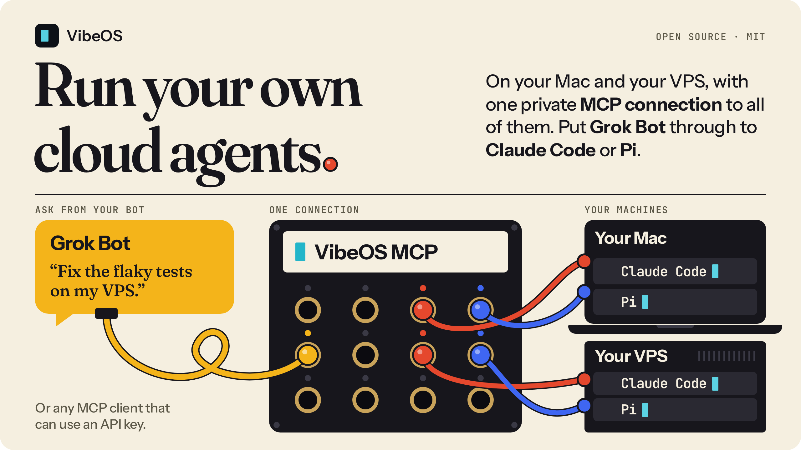

  

<h1 align="center">VibeOS</h1>

  <strong>Cloud agents you run yourself, on your Mac and your VPS, with one private MCP connection to all of them.</strong>

  <a href="https://github.com/tsconfigdotjson/vibe-os-native/releases/latest"><strong>Download for Mac</strong></a>
  &nbsp;·&nbsp;
  <a href="docs/mcp-and-networking.md"><strong>Read the docs</strong></a>

Apple Silicon · macOS 26 or later · <a href="LICENSE">MIT</a>

## Your agents, on your machines

VibeOS turns your Mac into a private home for coding agents. Add a Linux VPS by its SSH address and it joins the same list. There's no VibeOS cloud in the middle.

Every agent gets its own git worktree and its own compartment, so you can hand out several jobs at once. Quit the app and they keep working. When one goes idle it sleeps, and a new message wakes it.

## One private connection to all of them

MCP is the main way in. Your Mac's endpoint lists and drives the agents on that Mac and on every Linux host linked to it. A Linux host's endpoint does the same while the Mac is online.

It stays private. MCP listens on the machine itself, plus your own Tailscale network if you turn that on, and every call needs an API key. [How to connect →](docs/mcp-and-networking.md)

## Your main line from Grok Bot to Claude Code or Pi

Connect Grok Bot to your endpoint with an API key, and it can start a Claude Code or Pi agent, send it work, and read what comes back. Each project's profiles decide which agent runs and where.

Grok Bot needs a route to that endpoint: the same machine, or your Tailscale network. Any other MCP client that can use an API key connects the same way.

## A glance from the menu bar, a terminal when you want one

The menu bar shows what every agent is doing, on every host, and tells you when one needs you. Click an agent and Terminal opens on its live session. Close the window and the work carries on.

  <picture>
    <source media="(prefers-color-scheme: dark)" srcset="docs/images/menu-dark.png">
    
  </picture>

Screenshot shows a fictional demo workspace.

## Get started

1. **[Download the latest release](https://github.com/tsconfigdotjson/vibe-os-native/releases/latest)** and open the DMG.
2. Drag VibeOS into Applications and launch it. Follow the welcome checklist.
3. Add a project, then choose **New Agent…** in the menu.

To add a VPS, go to **Settings → Hosts → Add Linux Host…** with any server you can already reach by SSH key. To connect a client, make a key in **Settings → API Keys**.

## Good to know

- **A sleeping Mac pauses the agents on it.** A Linux host can keep its own agents going and keep answering MCP for them. Anything reached through the Mac shows as unavailable until it's back.
- **Tailscale is optional.** You only need it to reach MCP from another machine.
- **An API key has full access.** Treat it like a password.
- **VibeOS is built for one owner:** one Mac and any number of Linux hosts.

## Learn more

- [MCP and networking](docs/mcp-and-networking.md): endpoints, API keys, Tailscale and the MCP tools
- [Developing VibeOS](docs/development.md): layout, building and releases
- [PRD](PRD.md): the design and the source of truth
- [Contributing](CONTRIBUTING.md) · [Issues](https://github.com/tsconfigdotjson/vibe-os-native/issues)

Released under the [MIT License](LICENSE).
